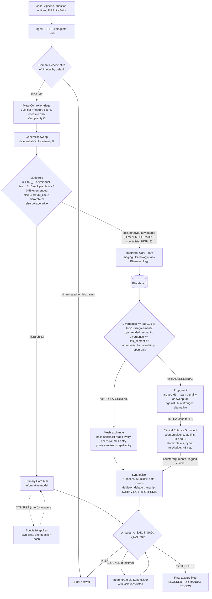

# DynaClinic MVP

DynaClinic is the research target of this fork, from the proposal *"DynaClinic: A Dynamic Architecture Switching Multi-Agent Framework in Healthcare Settings"*. It claims that a clinical decision-support system should switch architecture per case. A Meta-Controller sends simple cases to a single Primary Care Agent and complex ones to an Integrated Care Team that shares a Blackboard. When the team disagrees, a Clinical Critic takes over in adversarial mode, and safety gates check every answer before release. This MVP makes that switching runnable and measurable on synthetic multiple-choice vignettes. It is a research prototype and not clinical advice.

Code: `dynaclinic/` (pure-Python pipeline and eval harness), `yaml_instance/dynaclinic_mvp.yaml` with `dynaclinic/devall_nodes.py` (DevAll workflow), and `data/dynaclinic/synthetic_cases.jsonl` (24 hand-authored cases).

## Proposal component -> module

This table follows the extended draft the MVP was built from. For a check against the **reviewed** proposal (DynamiClinic: L0 to L4, three modes, complexity and uncertainty scores), with real runs of its own examples and citation notes, see [proposal-alignment.md](proposal-alignment.md).

Status key: **implemented** means the behaviour is in code. **prompt-level** means it rests only on an LLM prompt. **stub** means a simplified stand-in behind the proposal's interface. **not implemented** means absent.

| Proposal component | Module | Status | Notes |
|---|---|---|---|
| Meta-Controller: Complexity Score C | `dynaclinic/triage.py` (`complexity`) | implemented | LLM tier plus a deterministic feature score; an LLM LOW is bumped to MODERATE when the score is high, and never lowered. C = max(tier level, feature density) in [0, 1]; see [Meta-Controller](#meta-controller-complexity-uncertainty-mode-rule). |
| Meta-Controller: Uncertainty Score U (generalist sweep) | `dynaclinic/uncertainty.py`, `prompts.sweep_system`, `pipeline.CaseRun.uncertainty`; DevAll `dc_uncertainty` (`GeneralistSweep`) | implemented | One generalist call returns a probability-weighted differential; U is its normalised Shannon entropy. The probabilities are the model's self-report, not calibrated. |
| Meta-Controller mode rule (hierarchical / collaborative / adversarial) | `uncertainty.select_mode`, `uncertainty.tau_u_for` | implemented | The reviewed proposal's piecewise rule on C and U. tau_u depends on the input form (multiple choice or open-ended) and is calibrated on the eval vignettes, not validated against outcomes (see Key thresholds). |
| Hierarchical mode: Primary Care hub, specialist spokes | `prompts.hub_system` / `spoke_system`, `pipeline.CaseRun.primary_care`, `parsing.consult_requests` | implemented | The hub may ask up to 2 specialists one question each (`CONSULT:` lines); spokes answer from their own slice only, concurrently, never seeing each other. |
| Primary Care Agent, Emanuel & Emanuel Informative model | `prompts.py` (`_PRIMARY_CARE`), `pipeline.CaseRun.primary_care` | prompt-level | Paternalistic and interpretive language is forbidden by the prompt only. No checker enforces it. |
| Integrated Care Team (Imaging, Pathology/Lab, Pharmacology) | `prompts.specialist_block`, `pipeline.CaseRun.care_team` | implemented | Each specialist gets its modality slice, plus the shared case summary under the default `shared_core` context policy (see [Context policy](#context-policy)). Specialists run concurrently. LOW (only reached in adversarial mode by uncertainty) and MODERATE use 2 specialists, HIGH uses 3. |
| L3 shared Blackboard | `dynaclinic/blackboard.py` | implemented | In-memory, append-only, one per case. In round 1 specialists never see each other's entries; only the collaborative mesh exchange shows each specialist its peers' round-1 entries. |
| Meta-Controller tier 2: conflict-aware routing (divergence, Conflict Set, tau) | `dynaclinic/divergence.py` | implemented | Multiple choice: mean pairwise Jensen-Shannon distance; switches if `>= tau` or the top-1 answers disagree. Open-ended cases: mean pairwise cosine distance between the specialists' `LEADING DIAGNOSIS` phrases (the proposal's D(H1, H2) over the primary diagnostic assertions); their `DOMAIN RECOMMENDATION` lines go to the Blackboard, never into the distance. Switches if `>= tau_semantic` or fewer than two specialists name a diagnosis. In adversarial mode entered by uncertainty it only reports: the mode stays adversarial. |
| Multi-label margin loss | `divergence.margin_loss`, `eval/grade.py` | implemented (eval only) | Calibration metric on the team's mean distribution. It needs the gold answer, so it is never used for live routing. |
| Collaborative mesh exchange | `pipeline.CaseRun.mesh_exchange`, `prompts.mesh_system` / `mesh_block`; DevAll `dc_mesh_exchange` (`MeshExchange`) | implemented | After the Conflict Detector, each specialist (role `<role>_mesh`) reads its own and every peer's round-1 entry and posts a revised step-2 entry, stating what it adopts or disputes from each peer. Specialists run concurrently. The detector is not re-run; `distributions` / `assertions` keep round 1. The Consensus Builder integrates both rounds. |
| Adversarial debate: Proponent / Opponent / Mediator | `pipeline.select_hypotheses`, `CaseRun.proponent` / `critic` / `synthesize`, `prompts._PROPONENT` / `OPPONENT_SYSTEM` / `MEDIATOR`; DevAll `dc_proponent` (`Proponent`) | prompt-level | One round, for both entry reasons (uncertainty, conflict). H1 = the team's plurality hypothesis (option letter, or leading diagnosis), else the sweep's top differential; H2 = the dissenter's hypothesis, else the next differential. The Proponent argues H1; the Critic's decomposition call also argues as Opponent against H1 and H2; the Synthesizer as Mediator reads the transcript and states `SURVIVING HYPOTHESIS:` before answering. Recorded in `RunResult.debate`. The static arm keeps the classic Critic. |
| Clinical Critic: atomic-claim decomposition | `dynaclinic/critic.py`, `prompts.py` | prompt-level | One LLM call splits the Blackboard into claims. A malformed reply falls back to the specialists' own claims. In the dynamic arm's debate the same call is the Opponent's (`CriticReport.opponent`). |
| Adaptive hybrid rule / LLM-judge estimator | `dynaclinic/critic.py` | implemented | Rule score = token grounding plus a KB veto. The judge's logits are temperature-scaled, and `lambda = sigmoid(k (var(r) - v0))`. The judge itself is an LLM call. |
| L1 FHIR ingestion into Neo4j | `interfaces.FHIRLiteIngestor`, `InMemoryGraphStore` | stub | Flat `structured` dict fields become text sections plus an in-memory dict graph. No FHIR parsing and no Neo4j. |
| L2 MCTS control plane (PUCT, reward, backtracking) | `interfaces.GreedyPlanner` | stub | A fixed greedy policy picks each stage. Reward `alpha*dMissing + beta*dConf - gamma*stagnation` is logged in the route only. No tree search. |
| L4 A_SAD (activity precedence) | `safety.py`, `kb.precedence_violations` | implemented | Regex rules over a small hand-written precedence list. |
| L4 T_SAD (trace rules) | `safety.py`, `kb.patient_conflicts` | implemented | Allergy class, contraindication and interaction checks against an illustrative KB. A block triggers 1 regeneration, then `BLOCKED FOR MANUAL REVIEW`. |
| L4 S_NAP (next-activity predictor) | `safety.py` | stub | Always passes, with the note "not implemented (stub)". |
| L4 trust-region constraint | none | not implemented | |
| L5 working memory | `pipeline.CaseRun` / `RunResult`; DevAll `global_state["dynaclinic"]` | stub | Per-case run state only. |
| L5 experience memory (BioBERT + Qdrant) | `interfaces.HashingEmbeddingMemory`, `kb.py` | stub | Hashing-trick bag-of-words vectors with exact cosine search, plus a static hand-written KB. No BioBERT, no Qdrant, no learning. |
| L5 verified semantic cache | `interfaces.InMemorySemanticCache` | stub | In-memory, stores gate-verified answers only, hit at cosine >= 0.97, re-gated on hit. Off in eval unless `--cache` is passed. |
| CSEDB safety metrics | none | not implemented | The eval reports *safety violation*: the final answer is one of the case's hand-labelled `unsafe_options`. That is not a CSEDB score. |
| Baselines | `pipeline.SingleAgentPipeline`, `pipeline.StaticTeamPipeline` | implemented | Single generic clinician, and an always-full team with Critic and gate (exhaustive consensus). |
| DevAll workflow | `devall_nodes.py`, `register.py`, `functions/edge/dynaclinic_conditions.py`, `yaml_instance/dynaclinic_mvp.yaml` | implemented | 10 `dc_*` node types. Edges route only on first-line markers `ROUTE:` / `MODE:` / `GATE:`. |
| Evaluation harness | `dynaclinic/eval/` (`cases.py`, `grade.py`, `harness.py`) | implemented | Synthetic set (24 cases) and a 50-question MedQA-USMLE sample (`data/dynaclinic/medqa_sample.jsonl`) in the repo; results in `docs/dynaclinic/results/` and the Results section below. |

## Dynamic pipeline



In the pure pipeline, the `GreedyPlanner` stub picks each stage (triage, then the uncertainty sweep, then primary care or the team by the chosen mode) and logs its reward as `planner:<action>:<reward>` in `RunResult.route`. In DevAll, the graph itself is the policy, and the planner and cache are not used.

## Meta-Controller: complexity, uncertainty, mode rule

The reviewed proposal's Meta-Controller picks one of three modes from two scores.

**Complexity Score C** (`triage.complexity`, after tier triage). `C = max(level(LLM tier), density)` with `level` LOW 0, MODERATE 0.75, HIGH 1 (0 when the LLM tier is missing or malformed) and `density = min((score + 0.5) / (2 * threshold), 1)`, where `score` is the deterministic feature score and `threshold` the escalation threshold (`escalate_threshold`, default `MODERATE_SCORE` 6; threshold 0 gives density 1). `tau_c = 0.5` is chosen so that `C > tau_c` exactly when the effective tier is MODERATE or HIGH: an LLM MODERATE/HIGH gives level >= 0.75, a score at or above the threshold (the escalation case) gives density > 0.5, and a LOW tier below the threshold gives at most `(threshold - 0.5) / (2 * threshold) < 0.5`. When the LLM tier is missing, the pure pipeline's deterministic tier uses `MODERATE_SCORE`, and so does C. A test checks this equivalence over scores 0-30, every LLM tier and several thresholds.

**Uncertainty Score U** (`CaseRun.uncertainty`, `dc_uncertainty`). One generalist call (role `generalist`, JSON mode, the full case block) returns `{"differential": [{"hypothesis", "probability"}]}`. For a multiple-choice case the hypotheses are option letters (k = the number of options; other hypotheses are ignored); for an open-ended case they are the top-k diagnostic differentials (default k = 5). Duplicate hypotheses are summed, the list is cut to the k most probable and renormalised. `U = H(p) / ln k` with `H(p) = -sum p_i ln p_i`, clamped to [0, 1]: 0 for one certain hypothesis, 1 for a uniform spread over k. A failed call or a malformed reply (no differential list, a negative, non-numeric or NaN probability, no positive mass) leaves U unmeasured (`n/a`, warning `generalist: ...; U not measured, routed on C only`), and the rule reads it as 0, so a missing sweep never makes a case adversarial.

**Mode rule** (`uncertainty.select_mode`): `U > tau_u` -> adversarial; else `C <= tau_c` -> hierarchical; else collaborative. tau_u depends on the input form (`uncertainty.tau_u_for`): 0.15 for multiple choice, 0.59 for open-ended, because k, and so the scale of U, differ (see Key thresholds); `tau_u=` overrides both. `RunResult` records `complexity`, `uncertainty`, `tau_c`, `tau_u` (the value applied), `top_k`, `differential`, `mode_reason` (e.g. `C 0.12 <= tau_c 0.5 and U 0.00 <= tau_u 0.15: hierarchical`) and the route gets `uncertainty:<U|n/a>` and `mode:<mode>[:uncertainty]`. Adversarial mode entered by uncertainty runs the team (2 specialists for a LOW or MODERATE tier), then the adversarial debate even when the team agrees: the Conflict Detector still computes and reports the divergence, but cannot switch back to collaborative. Collaborative mode can still switch to adversarial on divergence, as before.

**Hierarchical mode (hub and spoke).** The Primary Care Agent is the hub. Its Informative-model prompt adds a protocol: when it needs a specialist's reading of this patient's data, it replies with at most two lines `CONSULT: <imaging|pathology|pharmacology>: <question>` instead of an answer. Each named specialist (role `<role>_consult`) gets only its own modality slice (under the run's context policy) and the hub's question, answers in at most three sentences, and never sees another spoke's question or answer; spokes run concurrently. A second hub call gets the case plus the answers and gives the final reply. Unknown roles and CONSULT lines beyond two are ignored with a warning; a failed spoke call is answered `(no answer: the call failed)` with a warning; no CONSULT lines means one hub call, as before. `RunResult.consults` lists `{role, question, answer}`. The DevAll `PrimaryCare` node prints the consults above the answer.

**Collaborative mode (mesh).** The specialists first write independent round-1 hypotheses, and the Conflict Detector compares only those. If the team stays collaborative, it becomes a fully connected mesh (`mesh_exchange`, route `mesh_exchange:<roles>`): each specialist (role `<role>_mesh`) gets its round-1 input again, its own round-1 entry once and every peer's round-1 entry, and replies in the round-1 format plus an `exchange` list (`{"peer", "stance": "adopts|disputes", "point"}`). Its reply is a step-2 entry on the Blackboard with `adopts <peer>: ...` / `disputes <peer>: ...` lines. A failed or malformed reply leaves that specialist's round-1 entry standing (warning); fewer than two round-1 entries skip the exchange (`mesh_exchange:skipped`). The detector is not re-run, and `distributions` / `assertions` keep round 1. The Consensus Builder reads both rounds and is told to integrate them into one unified differential.

**Adversarial mode (debate).** One round, whichever way adversarial mode was entered. `select_hypotheses` picks H1, the team's plurality hypothesis: the specialists' top-1 letters without abstainers, or for an open-ended case their leading diagnoses, matched after case and punctuation folding. On a tie or with no votes it takes the generalist sweep's top differential. H2, the strongest alternative, is the next most voted team hypothesis (the dissenter's), else the sweep's first other differential. The Proponent (role `proponent`, route `proponent`) gets the case as the Synthesizer sees it, the Blackboard, H1 with how it was chosen, and H2. It replies `CASE FOR H1:`, `WOULD FALSIFY H1:`, `AGAINST H2:`. The Clinical Critic's decomposition call then also acts as the Opponent: its prompt adds the patient evidence, H1, H2 and the Proponent's case, and it adds `"opponent": {"against_h1": [...], "against_h2": [...]}` to its JSON, citing logical leaps, contradicting findings or trial evidence, and contraindications. Claim scoring and flagging are unchanged. The Synthesizer, as the Mediator, reads the transcript (H1, H2, the Proponent's case, the Opponent's counterevidence against each) and the flagged claims. It must begin `SURVIVING HYPOTHESIS: <H1|H2|neither> - <why>`, then answer in the usual format (FINAL ANSWER parsing is unchanged). `RunResult.debate` holds `h1`, `h2`, `basis`, `proponent` and `opponent`. With nothing to debate, or when the Proponent call fails, the Critic runs its classic review (warning). The static arm never debates.

**DevAll.** `GeneralistSweep` (`dc_uncertainty`, config `tau_u_mcq` 0.15, `tau_u_open` 0.59, optional `tau_u` overriding both, `k`) runs after `Triage` and emits `MODE: HIERARCHICAL|COLLABORATIVE|ADVERSARIAL`, then `Complexity C=.. (tau_c 0.5), Uncertainty U=.. (tau_u 0.15 for multiple choice, k ..)` (or `for open-ended`, or `configured override`), the rule and the differential. `dc_mode_hierarchical` routes to `PrimaryCare`, `dc_mode_team` to `CareTeam`. It calls the LLM but is not a 3D character (its node type is not agent-like); its events show as System in the 3D log. After `DivergenceGate`, `dc_mode_collaborative` routes to `MeshExchange` (`STAGE: mesh_exchange`, one line per specialist: the peers it read, what it adopts or disputes, its revised answer) and then `Synthesizer`. `MeshExchange` is not a 3D character either, because the specialists already are the Care Team's. `dc_mode_adversarial` routes to `Proponent` (`STAGE: proponent`, H1 and H2, then its case; a 3D character), then `Critic` (`STAGE: critic (Opponent)`, the counterarguments against H1 and H2, then the flagged claims), then `Synthesizer`. The harness reports mean C, mean U and the number of cases with U unmeasured for the dynamic arm (`summary.json`, and a Meta-Controller table in `summary.md` with the tau_u used per form and the adversarial entries by U and by conflict). `results.jsonl` rows carry `debate`.

**Open-ended cases.** A case without answer options (any clinical text, e.g. "a patient has COVID-19 on a sunny day") gets a sectioned write-up (ASSESSMENT, DIFFERENTIAL, PLAN, RED FLAGS / ESCALATE IF, MISSING INFORMATION) ending in `RECOMMENDATION:`, never a letter; the report heads it `Assessment and plan:`. Each specialist ends its reply with two lines: `LEADING DIAGNOSIS: <what is wrong with the patient, a short noun phrase>` (or `ABSTAIN`) and `DOMAIN RECOMMENDATION: <its action from its own lens>`. A reply with only the older `PRIMARY ASSERTION:` line has that line read as the diagnosis (warning). The divergence is the mean pairwise cosine distance `1 - cos` (clipped to [0, 1]) between the non-abstaining leading diagnoses, embedded with the client's `text-embedding-3-small` or, when the client has no embedder or the call fails (warning), the `HashingEmbeddingMemory` stub. Recommendations are not embedded: three lenses on one diagnosis (a real PE run: CT angiography, D-dimer interpretation, anticoagulation timing) read as divergence 0.35-0.37 and went adversarial when the specialists' actions were compared. They stay on the Blackboard, so the Synthesizer, the Critic and the care-team stage output see them. The gate prints the divergence, `tau_semantic`, the embedder and every leading diagnosis. With fewer than two diagnoses it is not measurable and the team goes adversarial (safety-biased). The synthesizer stage is labelled `Consensus Builder` (collaborative) or `Mediator (Conflict Resolver)` (adversarial).

## How to run

To watch DynaClinic in the three.js office (Primary Care, collaborative care team, adversarial Critic, with screenshots mapped to the proposal), follow [runbook/README.md](runbook/README.md), or watch the captioned demo in [runbook/demo.html](runbook/demo.html).

All commands run from the repo root. `.env` provides `OPENAI_API_KEY`, `OPENAI_BASE_URL`, `DYNACLINIC_MODEL` and the comma list `DYNACLINIC_FALLBACK_MODELS`. If the primary model is missing or unavailable, the client switches to the next model for the rest of the run (sticky fallback).

**Pure pipeline (Python):**

```python
from dynaclinic.eval.cases import load_synthetic
from dynaclinic.llm import client_from_env
from dynaclinic.pipeline import DynaClinicPipeline, SingleAgentPipeline, StaticTeamPipeline

case = next(c for c in load_synthetic() if c.id == "syn-high-06")
result = DynaClinicPipeline(client_from_env()).run(case)  # never raises on model errors; see result.error
print(result.tier, result.mode, result.final_answer, result.blocked, [c.model for c in result.calls])
```

**DevAll workflow (SDK):** the task prompt is the case as free text, or as one `Case` JSON object. The parent coordinator verified this invocation live on gpt-6-luna: `syn-low-02` and `syn-high-06` were both answered correctly, with all gates PASS.

```python
import json
from dynaclinic.eval.cases import load_synthetic
from runtime.sdk import run_workflow

case = next(c for c in load_synthetic() if c.id == "syn-low-02")
run = run_workflow("yaml_instance/dynaclinic_mvp.yaml", task_prompt=json.dumps(case.to_dict()), session_name="dc_syn_low_02")
print(run.final_message.text_content())  # Report node; run.meta_info.output_dir holds node_outputs.yaml
```

**DevAll workflow (CLI):** `run.py` reads one line from stdin, so pass a JSONL line or free text:

```bash
grep '"syn-high-06"' data/dynaclinic/synthetic_cases.jsonl | env -u PYTHONPATH -u VIRTUAL_ENV uv run python run.py --path yaml_instance/dynaclinic_mvp.yaml --name dc_mvp
```

**Eval harness:**

```bash
# offline plumbing check: FakeLLM with valid, pseudo-random scripted replies
env -u PYTHONPATH -u VIRTUAL_ENV uv run python -m dynaclinic.eval.harness --dry-run --out /tmp/dc_dry
# live run of all three arms over the 24 synthetic cases
env -u PYTHONPATH -u VIRTUAL_ENV uv run python -m dynaclinic.eval.harness --arms dynamic,single,static --dataset synthetic --concurrency 4
```

Harness flags:

- `--limit N`: run only the first N cases.
- `--seed S`: shuffle the cases before `--limit`.
- `--cache`: enable the semantic cache.
- `--out DIR`: output directory. Default: `docs/dynaclinic/results/<UTC timestamp>-<model>`.
- `--context-policy strict|shared_core`: what the care team and Synthesizer see (dynamic and static arms). Default: `shared_core`.
- `--dataset synthetic,medqa`: add the MedQA sample. If `data/dynaclinic/medqa_sample.jsonl` is absent, the harness prints `no MedQA sample at <path>; skipping`.

Outputs:

- `results.jsonl`: one row per (case, arm), holding `RunResult` plus grades and the run's `context_policy`. No prompts; API key values are redacted.
- `summary.json`: run settings (including `context_policy`, also in the `summary.md` header) and the metrics below.
- `summary.md`: a per-arm table (accuracy with 95% Wilson CI, triage accuracy, routes, adversarial-switch rate, divergence, team margin loss, safety violations, blocked, errors, calls, tokens, latency, models and fallback calls, cost), accuracy per gold tier, and a case x arm answer matrix.

Behaviour:

- **Resume:** rerun with the same `--out`. Pairs already present are skipped, including errored ones (errors are measured outcomes).
- **Concurrency:** each worker thread owns its own client, because `run()` resets the client's call ledger.
- **Cost:** reported only when `DYNACLINIC_PRICE_<MODEL>_IN` and `DYNACLINIC_PRICE_<MODEL>_OUT` (USD per 1M tokens) are set for every model used. For example, `DYNACLINIC_PRICE_GPT_6_LUNA_IN` (non-alphanumerics become `_`). Otherwise cost is `n/a`.

## Context policy

`context_policy` sets how much of the case the Integrated Care Team and the Synthesizer see. It is a `DynaClinicPipeline` / `StaticTeamPipeline` argument, the harness flag `--context-policy`, and an optional `context_policy` field on the `dc_care_team` and `dc_synthesizer` nodes (the `dc_synthesizer` value also applies to `dc_safety_gate` regenerations).

- `strict`: each specialist sees only its modality slice (Imaging: imaging studies and the vignette sentences that mention imaging; Pathology/Lab: labs; Pharmacology: meds and allergies), plus the question and options. The Synthesizer sees the question, options and Blackboard. This mirrors the proposal's bounded-context personas.
- `shared_core` (default): each specialist first gets a "Shared case summary" (vignette, demographics, question, options), then its slice under "Your modality data (focus here)". The persona still has to reason from its modality and not prescribe outside its role. The Synthesizer gets the full case block (vignette, every structured section, question, options) before the Blackboard.
- Open-ended cases: under `shared_core` each specialist names the leading diagnosis from the whole narrative, gives its recommendation through its own lens, and writes `LEADING DIAGNOSIS: ABSTAIN` only when the scenario holds nothing for its domain (an empty slice is not a reason); the Pathology/Lab and Pharmacology slices also quote the vignette sentences that mention a lab or a drug (keyword heuristics `prompts._LAB_TERMS`, `prompts._DRUG_TERMS`), and MODERATE team selection counts them as data. Under `strict` a specialist sees its slice only and abstains when it is empty.

`shared_core` is the default because the strict baseline eval (`results/2026-10-27-full-gpt-6-luna/`) lost information. Under `strict`, case facts that sit only in the vignette, such as presenting symptoms, reached no specialist, and the Synthesizer (question, options and Blackboard only) could not recover them. The Critic does not depend on the policy: decomposition reads the Blackboard, and the judge and rule score always use the full case.

## Key thresholds

| Parameter | Default | Where |
|---|---|---|
| tau_c (Complexity Score: hierarchical vs collaborative) | 0.5, by construction (C > 0.5 exactly when the effective tier is MODERATE or HIGH) | `triage.TAU_C`; recorded as `RunResult.tau_c` |
| tau_u, multiple choice (Uncertainty Score: adversarial regardless of C) | 0.15: the 75th percentile of U (p50 0.086, p90 0.342) over MedQA-50 + synthetic-24 (n = 74, k = the option count); calibrated, not validated against outcomes | `uncertainty.TAU_U_MCQ`, `uncertainty.tau_u_for`; `DynaClinicPipeline(tau_u_mcq=)`; `dc_uncertainty` config `tau_u_mcq` |
| tau_u, open-ended | 0.59: the 75th percentile of U (p50 0.385, p90 0.744) over the same 74 vignettes without options or question (k = 5); calibrated, not validated against outcomes | `uncertainty.TAU_U_OPEN`; `DynaClinicPipeline(tau_u_open=)`; `dc_uncertainty` config `tau_u_open`. `DynaClinicPipeline(tau_u=)` / config `tau_u` overrides both forms |
| Generalist sweep k (open-ended differentials; multiple choice: the option count) | 5 | `uncertainty.DEFAULT_K`; `DynaClinicPipeline(top_k=)`; `dc_uncertainty` config `k` |
| Hub consults per case | at most 2 | `parsing.MAX_CONSULTS` |
| tau (adversarial switch on divergence) | 0.25 | `divergence.TAU`; `DynaClinicPipeline(tau=)`; `dc_divergence_gate` config `tau` |
| tau_semantic (open-ended switch on the semantic divergence of the leading diagnoses) | hashing 0.595 (calibrated: 19/20 on a 10 same + 10 different diagnosis pair fixture of sentences that lead with the diagnosis, some with a treatment clause; not re-calibrated for the shorter diagnosis phrases); text-embedding-3-small 0.35 (prior, not validated) | `divergence.TAU_SEMANTIC`; `DynaClinicPipeline(tau_semantic=)`; `dc_divergence_gate` config `tau_semantic` (overrides both) |
| Conflict Set spread | 0.3 | `divergence.SPREAD_THRESHOLD` |
| Margin (margin loss) | 0.2 | `divergence.MARGIN` |
| Abstention (near-uniform specialist, no vote) | normalized entropy >= 0.95 | `divergence.ABSTAIN_ENTROPY` |
| Rule score for a KB-confirmed safety warning | 0.95 | `critic.KB_CONFIRMED_SCORE` |
| Feature-score tier cut-offs / escalation | MODERATE >= 6, HIGH >= 12; escalate LLM LOW at >= 6 | `triage.MODERATE_SCORE`, `triage.HIGH_SCORE`; `DynaClinicPipeline(escalate_threshold=)`; `dc_triage` config |
| Judge temperature T | 1.5 | `critic.JUDGE_TEMPERATURE` |
| Hybrid weight `lambda = sigmoid(k (var(r) - v0))` | k = 10, v0 = 0.05 | `critic.LAMBDA_K`, `critic.LAMBDA_V0` |
| Claim flag threshold (hybrid) | < 0.5, or any KB contradiction | `critic.FLAG_THRESHOLD` |
| Safety-gate regenerations | 1 | `DynaClinicPipeline(max_rollbacks=)`; `dc_safety_gate` config `max_rollbacks` |
| Primary-care self-consistency samples | 1 | `DynaClinicPipeline(pca_samples=)`; `dc_primary_care` config |
| Semantic-cache hit | cosine >= 0.97 | `InMemorySemanticCache(threshold=)` |
| Planner reward weights | alpha 1.0, beta 1.0, gamma 0.5 | `GreedyPlanner` |

## Known limitations

- **Thresholds are not validated.** The triage cut-offs (`MODERATE_SCORE` / `HIGH_SCORE`) were chosen by inspecting the same 24 synthetic vignettes the eval uses, so triage accuracy on that set is in-sample. tau and the critic constants are the proposal's or hand-picked values and have not been tuned or validated on held-out data. The two tau_u values are the 75th percentile of U on the eval's own 74 vignettes (and their open-ended copies), so routing on those sets is in-sample, and no outcome (accuracy, safety) informed them.
- **U rests on self-reported probabilities.** The generalist's probabilities are not calibrated, and one sample is taken; a model that is over-confident by habit will rarely exceed tau_u. The tau_u percentiles come from one sweep per vignette with one model.
- **Mesh and debate are one round.** Real runs (2026-10-28, see Results) exercised both: adversarial on 17 of 50 MedQA questions and on all four proposal examples; in 11 of 20 collaborative MedQA cases every specialist abstained in round 1, so the mesh had nothing to exchange. H1/H2 votes match after case and punctuation folding only: paraphrased diagnoses split the vote, and the sweep's top differential then decides. The Opponent shares the Critic's decomposition call, so a reply without the `opponent` object leaves the Mediator only the Proponent's case (warning). The `SURVIVING HYPOTHESIS` line is neither parsed nor graded.
- **Small datasets.** The synthetic set is 24 hand-authored textbook vignettes (8 per tier), and the MedQA sample is 50 questions (see Results), so confidence intervals are wide.
- **The KB is illustrative.** `kb.py` is a small, hand-written list of drug classes, interactions, contraindications and precedence rules. T_SAD and A_SAD catch only what it lists.
- **Negation handling is heuristic.** Regex patterns ("no", "not", "avoid", "instead of") decide whether a drug is asserted. Unusual phrasing can produce false gate blocks or misses.
- **The Critic, judge, triage and specialists are LLM-prompted.** Their quality depends on the model. The Informative-model constraint and the claim decomposition are not checked by code.
- **Single-run variance.** Each case is run once per arm. The pipelines never set a temperature, so provider defaults apply, and the client drops `temperature` for models that reject it. Repeated runs can differ.
- **Stubs.** No FHIR, Neo4j, MCTS, BioBERT, Qdrant, S_NAP, trust region or CSEDB. The MVP reports no scores for any of them.
- **Safety-violation definition.** A final answer in `unsafe_options` counts as a violation even when the gate blocked it. The blocked rate is reported separately.
- **Open-ended semantic divergence is weak evidence.** The hashing fallback is lexical: its calibrated tau_semantic separates the 20-pair fixture with a margin of 0.007 (same-diagnosis max 0.592, different min 0.599, one different pair at 0.522 missed), and paraphrases with no shared words read as conflict. The text-embedding-3-small threshold is a prior, never run against the API. Embedding calls are not in the cost ledger.
- **Open-ended answers are not cached or graded.** `final_answer` is None, so the semantic cache never stores them, the eval harness has no gold to grade, and the planner's progress counts the answer as missing.

## Results

Full evaluation results: see docs/dynaclinic/results/ (each run folder has results.jsonl, summary.json, summary.md).

All runs: 24 synthetic cases (8 LOW / 8 MODERATE / 8 HIGH, 15 with safety traps), 3 arms, model gpt-6-luna (0 fallback calls, 0 errors), concurrency 4, cache off, 2026-10-27.

| run (folder) | context policy | code state | dynamic acc. | single acc. | static acc. | dynamic calls/case | static calls/case | blocked (dyn / static) | safety violations |
|---|---|---|---|---|---|---|---|---|---|
| 2026-10-27-full-gpt-6-luna | strict | 1b01dc2 | 91.7% (22/24) | 100% | 87.5% (21/24) | 5.08 | 6.12 | 0 / 2 | 0 |
| 2026-10-27-full-gpt-6-luna-shared-core | shared_core | 429fdf3 | 95.8% (23/24) | 100% | 100% | 4.75 | 6.17 | 2 / 3 (all correct answers, false blocks) | 0 |
| 2026-10-27-final-gpt-6-luna-shared-core | shared_core | 4c68201 (T_SAD precision + negation scope fixes) | 100% (24/24) | 100% | 100% | 4.67 | 6.08 | 0 / 1 | 0 |
| 2026-10-27-fixes-gpt-6-luna-shared-core | shared_core | 9ef6d86 (abstention in divergence, KB-credited critic) | 100% (24/24) | 100% | 100% | 3.92 | 6.08 | 1 / 1 (correct answers, false blocks) | 0 |

Latest run (fixes), dynamic arm: triage agreement with gold tier 17/24 (70.8%); routes single 6 / collaborative 18 / adversarial 0; adversarial switch 0.0% (was 37.5%); mean divergence 0.050 (was 0.326); mean latency 13.4 s (p50 12.9 s) vs static 21.4 s (p50 20.8 s) and single 2.2 s. The static arm's would-switch rate fell from 79.2% to 4.2%.

What the numbers support:
- Dynamic switching matches the always-full-team arm on accuracy while using ~36% fewer LLM calls per case (3.92 vs 6.08) and ~37% lower mean latency; LOW cases are answered by one Primary Care call plus triage.
- Most adversarial switches in the earlier runs were artifacts: a specialist with no opinion (uniform distribution) was counted as a top-1 vote. With abstentions excluded, no case on this set reaches tau, so the adversarial path is no longer exercised by this dataset. It is still covered by unit tests, and a harder benchmark with real disagreement is needed to evaluate it.
- Strict modality slicing (the proposal's bounded-context personas) lost information: both strict-arm dynamic misses (syn-high-07, syn-mod-06) came from specialists that never saw the presenting symptoms. shared_core fixed them and is the default.
- No arm ever chose an unsafe option on these cases; T_SAD blocks in earlier runs were false positives on correct answers, removed by the kb/safety fixes.

What they do NOT support:
- The single-agent baseline scores 100% at 1 call/case on this set: the synthetic vignettes are textbook-level and too easy to show any accuracy benefit from multi-agent collaboration (ceiling effect). A harder benchmark is needed before any accuracy claim; the 50-question MedQA sample below did not separate the arms either.
- One run per configuration and n = 24: differences of 1-2 cases are within the Wilson 95% intervals in each summary.md and within run-to-run model variance (triage agreement moved 62.5% -> 79.2% -> 70.8% across runs; triage code and prompts did not change between the last two).
- Costs are reported as token counts only (no prices configured).

### After f14 and f15 (uncertainty score, three modes; dynamic arm only)

Runs `2026-10-27-f14-*-dynamic-gpt-6-luna` (code be596a7, tau_u 0.8) and `2026-10-28-f15-*-dynamic-gpt-6-luna` (code 2cf1567, tau_u 0.15 / 0.59). Single and static arms are unchanged by f14/f15 (identical prompt hashes) and were not re-run.

| set | f14 dynamic | f15 dynamic [95% CI] | f15 modes | calls/case f14 -> f15 | latency mean f14 -> f15 |
|---|---|---|---|---|---|
| MedQA-50 | 94% (47/50) | 96% (48/50) [86.5, 98.9] | adversarial 17, collaborative 20, hierarchical 13 | 4.66 -> 6.94 | 14.9 -> 32.0 s |
| synthetic-24 | 100% | 95.8% (23/24) [79.8, 99.3] | adversarial 1, collaborative 18, hierarchical 5 | 5.04 -> 7.12 | 15.0 -> 24.9 s |

- All adversarial entries came from uncertainty (U > tau_u), none from the Conflict Detector. On MedQA 15 of 17 adversarial cases were correct, and both misses are adversarial; the Mediator kept H1 in 16 and answered "neither" once.
- syn-high-02: round 1's plurality was correct (C); after the mesh exchange the Consensus Builder answered D, the safety gate blocked it twice, and the case ended without an answer.
- Accuracy changes are within the intervals; calls per case rose about 40-50%. Proposal-example runs and their caveats: `proposal-alignment.md`.

### Weaker base model: qwen3.5-4b, three arms (2026-10-28)

Run `2026-10-28-qwen3.5-4b-medqa50-three-arms` (code 2cf1567 for the DynaClinic paths, local LM Studio `qwen3.5-4b` = qwen3-4b-2507 served through the OpenAI-compatible API via `OPENAI_BASE_URL` / `DYNACLINIC_MODEL`, concurrency 3, shared_core, cache off). Chosen to give the team headroom: gpt-6-luna is near ceiling.

| arm | accuracy [95% CI] | calls/case | latency mean (s) | modes |
|---|---|---|---|---|
| single | 68% (34/50) [54.2, 79.2] | 0.98 | 21.0 | single 50 |
| dynamic | 60% (30/50) [46.2, 72.4] | 8.32 | 76.5 | adversarial 49, hierarchical 1 |
| static | 62% (31/50) [48.2, 74.1] | 6.00 | 48.0 | adversarial 50 |

- Headroom exists now (single 68%), but the multi-agent arms do not use it: single beats dynamic on 6 questions and loses on 2 (exact McNemar p = 0.29); single vs static 5 / 2 (p = 0.45); dynamic vs static 5 / 6 (p = 1.0). No difference is significant at n = 50, and the direction favours the single agent.
- tau_u does not transfer across models: qwen's generalist is far less confident (U quartiles 0.09 / 0.51 / 0.65 / 0.74 / 0.94, mean 0.61), so 49 of 50 cases exceed the gpt-6-luna-calibrated tau_u 0.15 and go adversarial. The dynamic arm is then the static arm plus the Proponent and a generalist sweep, at 8.32 calls per question.
- Mediator verdicts: H1 28, H2 7, neither 4, no verdict line 11 (the 4B model often skips the required line).
- 2 errors (medqa-test-0730, single and static): LM Studio request timeout; counted as wrong.

### MedQA sample (harder benchmark)

`data/dynaclinic/medqa_sample.jsonl`: 50 questions drawn with `random.Random(2026).sample` from the 1,273-question test split of MedQA-USMLE 4-option (Jin et al. 2021; Hugging Face `GBaker/MedQA-USMLE-4-options`, file `phrases_no_exclude_test.jsonl`, CC-BY-4.0). Ids are `medqa-test-<row index>`; 26 Step 1, 24 Step 2&3. The records have no structured patient data and no `unsafe_options`, so A_SAD/T_SAD have little to check and the safety columns are not meaningful for this set.

Run `2026-10-27-medqa50-gpt-6-luna-shared-core` (code 3203fa4, gpt-6-luna, 0 fallback calls, 0 errors, concurrency 4, cache off):

| arm | accuracy [95% CI] | calls/case | latency mean / p50 (s) | routes | adv. switch |
|---|---|---|---|---|---|
| dynamic | 92.0% (46/50) [81.2, 96.8] | 3.68 | 19.9 / 13.2 | single 17, collaborative 33 | 0% |
| single | 94.0% (47/50) [83.8, 97.9] | 1.00 | 5.3 / 2.9 | single 50 | n/a |
| static | 90.0% (45/50) [78.6, 95.7] | 6.00 | 29.9 / 22.5 | adversarial 50 | 2% (would-switch) |

- Misses: 3 questions are missed by all three arms with the same wrong answer (0005, 0755, 0944), which points to model knowledge, not orchestration. medqa-test-0243 is missed only by the team arms (dynamic and static both C, single correct A); medqa-test-1230 only by static.
- No accuracy benefit from the multi-agent arms: the three intervals overlap almost entirely, and single is 1 case ahead of dynamic. gpt-6-luna is still near ceiling on MedQA, so the benchmark is still not hard enough to separate the arms. A larger sample, a weaker base model, or a harder set (e.g. MedQA cases with many distractors, or CSEDB-style safety cases) is the next step.
- Specialists agreed almost always (mean divergence 0.010, adversarial switch 0%), so the adversarial path was again not exercised.
