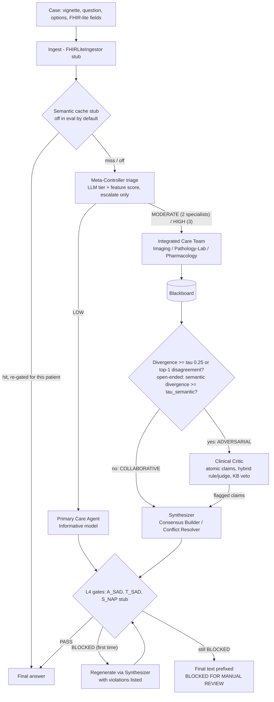

# DynaClinic MVP

DynaClinic is the research target of this fork, from the proposal *"DynaClinic: A Dynamic Architecture Switching Multi-Agent Framework in Healthcare Settings"*. It claims that a clinical decision-support system should switch architecture per case. A Meta-Controller sends simple cases to a single Primary Care Agent and complex ones to an Integrated Care Team that shares a Blackboard. When the team disagrees, a Clinical Critic takes over in adversarial mode, and safety gates check every answer before release. This MVP makes that switching runnable and measurable on synthetic multiple-choice vignettes. It is a research prototype and not clinical advice.

Code: `dynaclinic/` (pure-Python pipeline and eval harness), `yaml_instance/dynaclinic_mvp.yaml` with `dynaclinic/devall_nodes.py` (DevAll workflow), and `data/dynaclinic/synthetic_cases.jsonl` (24 hand-authored cases).

## Proposal component -> module

Status key: **implemented** means the behaviour is in code. **prompt-level** means it rests only on an LLM prompt. **stub** means a simplified stand-in behind the proposal's interface. **not implemented** means absent.

| Proposal component | Module | Status | Notes |
|---|---|---|---|
| Meta-Controller tier 1: complexity triage | `dynaclinic/triage.py` | implemented | LLM tier plus a deterministic feature score. An LLM LOW is bumped to MODERATE when the score is high, and never lowered. |
| Primary Care Agent, Emanuel & Emanuel Informative model | `prompts.py` (`_PRIMARY_CARE`), `pipeline.CaseRun.primary_care` | prompt-level | Paternalistic and interpretive language is forbidden by the prompt only. No checker enforces it. |
| Integrated Care Team (Imaging, Pathology/Lab, Pharmacology) | `prompts.specialist_block`, `pipeline.CaseRun.care_team` | implemented | Each specialist gets its modality slice, plus the shared case summary under the default `shared_core` context policy (see [Context policy](#context-policy)). Specialists run concurrently. MODERATE uses 2 specialists, HIGH uses 3. |
| L3 shared Blackboard | `dynaclinic/blackboard.py` | implemented | In-memory, append-only, one per case. Specialists never see each other's entries. |
| Meta-Controller tier 2: conflict-aware routing (divergence, Conflict Set, tau) | `dynaclinic/divergence.py` | implemented | Multiple choice: mean pairwise Jensen-Shannon distance; switches if `>= tau` or the top-1 answers disagree. Open-ended cases: mean pairwise cosine distance between the specialists' `PRIMARY ASSERTION` lines (the proposal's D(H1, H2)); switches if `>= tau_semantic` or fewer than two specialists assert anything. |
| Multi-label margin loss | `divergence.margin_loss`, `eval/grade.py` | implemented (eval only) | Calibration metric on the team's mean distribution. It needs the gold answer, so it is never used for live routing. |
| Clinical Critic: atomic-claim decomposition | `dynaclinic/critic.py`, `prompts.py` | prompt-level | One LLM call splits the Blackboard into claims. A malformed reply falls back to the specialists' own claims. |
| Adaptive hybrid rule / LLM-judge estimator | `dynaclinic/critic.py` | implemented | Rule score = token grounding plus a KB veto. The judge's logits are temperature-scaled, and `lambda = sigmoid(k (var(r) - v0))`. The judge itself is an LLM call. |
| L1 FHIR ingestion into Neo4j | `interfaces.FHIRLiteIngestor`, `InMemoryGraphStore` | stub | Flat `structured` dict fields become text sections plus an in-memory dict graph. No FHIR parsing and no Neo4j. |
| L2 MCTS control plane (PUCT, reward, backtracking) | `interfaces.GreedyPlanner` | stub | A fixed greedy policy picks each stage. Reward `alpha*dMissing + beta*dConf - gamma*stagnation` is logged in the route only. No tree search. |
| L4 A_SAD (activity precedence) | `safety.py`, `kb.precedence_violations` | implemented | Regex rules over a small hand-written precedence list. |
| L4 T_SAD (trace rules) | `safety.py`, `kb.patient_conflicts` | implemented | Allergy class, contraindication and interaction checks against an illustrative KB. A block triggers 1 regeneration, then `BLOCKED FOR MANUAL REVIEW`. |
| L4 S_NAP (next-activity predictor) | `safety.py` | stub | Always passes, with the note "not implemented (stub)". |
| L4 trust-region constraint | none | not implemented | |
| L5 working memory | `pipeline.CaseRun` / `RunResult`; DevAll `global_state["dynaclinic"]` | stub | Per-case run state only. |
| L5 experience memory (BioBERT + Qdrant) | `interfaces.HashingEmbeddingMemory`, `kb.py` | stub | Hashing-trick bag-of-words vectors with exact cosine search, plus a static hand-written KB. No BioBERT, no Qdrant, no learning. |
| L5 verified semantic cache | `interfaces.InMemorySemanticCache` | stub | In-memory, stores gate-verified answers only, hit at cosine >= 0.97, re-gated on hit. Off in eval unless `--cache` is passed. |
| CSEDB safety metrics | none | not implemented | The eval reports *safety violation*: the final answer is one of the case's hand-labelled `unsafe_options`. That is not a CSEDB score. |
| Baselines | `pipeline.SingleAgentPipeline`, `pipeline.StaticTeamPipeline` | implemented | Single generic clinician, and an always-full team with Critic and gate (exhaustive consensus). |
| DevAll workflow | `devall_nodes.py`, `register.py`, `functions/edge/dynaclinic_conditions.py`, `yaml_instance/dynaclinic_mvp.yaml` | implemented | 7 `dc_*` node types. Edges route only on first-line markers `ROUTE:` / `MODE:` / `GATE:`. |
| Evaluation harness | `dynaclinic/eval/` (`cases.py`, `grade.py`, `harness.py`) | implemented | Synthetic set (24 cases) and a 50-question MedQA-USMLE sample (`data/dynaclinic/medqa_sample.jsonl`) in the repo; results in `docs/dynaclinic/results/` and the Results section below. |

## Dynamic pipeline



In the pure pipeline, the `GreedyPlanner` stub picks each stage and logs its reward as `planner:<action>:<reward>` in `RunResult.route`. In DevAll, the graph itself is the policy, and the planner and cache are not used.

**Open-ended cases.** A case without answer options (any clinical text, e.g. "a patient has COVID-19 on a sunny day") gets a sectioned write-up (ASSESSMENT, DIFFERENTIAL, PLAN, RED FLAGS / ESCALATE IF, MISSING INFORMATION) ending in `RECOMMENDATION:`, never a letter; the report heads it `Assessment and plan:`. Each specialist ends its reply with `PRIMARY ASSERTION: <leading diagnosis or recommendation>` or `ABSTAIN`. The divergence is the mean pairwise cosine distance `1 - cos` (clipped to [0, 1]) between the non-abstaining assertions, embedded with the client's `text-embedding-3-small` or, when the client has no embedder or the call fails (warning), the `HashingEmbeddingMemory` stub. The gate prints the divergence, `tau_semantic`, the embedder and every assertion. With fewer than two assertions it is not measurable and the team goes adversarial (safety-biased). The synthesizer stage is labelled Consensus Builder (collaborative) or Conflict Resolver (adversarial).

## How to run

To watch DynaClinic in the three.js office (Primary Care, collaborative care team, adversarial Critic, with screenshots mapped to the proposal), follow [runbook/README.md](runbook/README.md), or watch the captioned demo in [runbook/demo.html](runbook/demo.html).

All commands run from the repo root. `.env` provides `OPENAI_API_KEY`, `OPENAI_BASE_URL`, `DYNACLINIC_MODEL` and the comma list `DYNACLINIC_FALLBACK_MODELS`. If the primary model is missing or unavailable, the client switches to the next model for the rest of the run (sticky fallback).

**Pure pipeline (Python):**

```python
from dynaclinic.eval.cases import load_synthetic
from dynaclinic.llm import client_from_env
from dynaclinic.pipeline import DynaClinicPipeline, SingleAgentPipeline, StaticTeamPipeline

case = next(c for c in load_synthetic() if c.id == "syn-high-06")
result = DynaClinicPipeline(client_from_env()).run(case)  # never raises on model errors; see result.error
print(result.tier, result.mode, result.final_answer, result.blocked, [c.model for c in result.calls])
```

**DevAll workflow (SDK):** the task prompt is the case as free text, or as one `Case` JSON object. The parent coordinator verified this invocation live on gpt-6-luna: `syn-low-02` and `syn-high-06` were both answered correctly, with all gates PASS.

```python
import json
from dynaclinic.eval.cases import load_synthetic
from runtime.sdk import run_workflow

case = next(c for c in load_synthetic() if c.id == "syn-low-02")
run = run_workflow("yaml_instance/dynaclinic_mvp.yaml", task_prompt=json.dumps(case.to_dict()), session_name="dc_syn_low_02")
print(run.final_message.text_content())  # Report node; run.meta_info.output_dir holds node_outputs.yaml
```

**DevAll workflow (CLI):** `run.py` reads one line from stdin, so pass a JSONL line or free text:

```bash
grep '"syn-high-06"' data/dynaclinic/synthetic_cases.jsonl | env -u PYTHONPATH -u VIRTUAL_ENV uv run python run.py --path yaml_instance/dynaclinic_mvp.yaml --name dc_mvp
```

**Eval harness:**

```bash
# offline plumbing check: FakeLLM with valid, pseudo-random scripted replies
env -u PYTHONPATH -u VIRTUAL_ENV uv run python -m dynaclinic.eval.harness --dry-run --out /tmp/dc_dry
# live run of all three arms over the 24 synthetic cases
env -u PYTHONPATH -u VIRTUAL_ENV uv run python -m dynaclinic.eval.harness --arms dynamic,single,static --dataset synthetic --concurrency 4
```

Harness flags:

- `--limit N`: run only the first N cases.
- `--seed S`: shuffle the cases before `--limit`.
- `--cache`: enable the semantic cache.
- `--out DIR`: output directory. Default: `docs/dynaclinic/results/<UTC timestamp>-<model>`.
- `--context-policy strict|shared_core`: what the care team and Synthesizer see (dynamic and static arms). Default: `shared_core`.
- `--dataset synthetic,medqa`: add the MedQA sample. If `data/dynaclinic/medqa_sample.jsonl` is absent, the harness prints `no MedQA sample at <path>; skipping`.

Outputs:

- `results.jsonl`: one row per (case, arm), holding `RunResult` plus grades and the run's `context_policy`. No prompts; API key values are redacted.
- `summary.json`: run settings (including `context_policy`, also in the `summary.md` header) and the metrics below.
- `summary.md`: a per-arm table (accuracy with 95% Wilson CI, triage accuracy, routes, adversarial-switch rate, divergence, team margin loss, safety violations, blocked, errors, calls, tokens, latency, models and fallback calls, cost), accuracy per gold tier, and a case x arm answer matrix.

Behaviour:

- **Resume:** rerun with the same `--out`. Pairs already present are skipped, including errored ones (errors are measured outcomes).
- **Concurrency:** each worker thread owns its own client, because `run()` resets the client's call ledger.
- **Cost:** reported only when `DYNACLINIC_PRICE_<MODEL>_IN` and `DYNACLINIC_PRICE_<MODEL>_OUT` (USD per 1M tokens) are set for every model used. For example, `DYNACLINIC_PRICE_GPT_6_LUNA_IN` (non-alphanumerics become `_`). Otherwise cost is `n/a`.

## Context policy

`context_policy` sets how much of the case the Integrated Care Team and the Synthesizer see. It is a `DynaClinicPipeline` / `StaticTeamPipeline` argument, the harness flag `--context-policy`, and an optional `context_policy` field on the `dc_care_team` and `dc_synthesizer` nodes (the `dc_synthesizer` value also applies to `dc_safety_gate` regenerations).

- `strict`: each specialist sees only its modality slice (Imaging: imaging studies and the vignette sentences that mention imaging; Pathology/Lab: labs; Pharmacology: meds and allergies), plus the question and options. The Synthesizer sees the question, options and Blackboard. This mirrors the proposal's bounded-context personas.
- `shared_core` (default): each specialist first gets a "Shared case summary" (vignette, demographics, question, options), then its slice under "Your modality data (focus here)". The persona still has to reason from its modality and not prescribe outside its role. The Synthesizer gets the full case block (vignette, every structured section, question, options) before the Blackboard.
- Open-ended cases: under `shared_core` each specialist reasons from the whole narrative through its own lens and writes `PRIMARY ASSERTION: ABSTAIN` only when the scenario holds nothing for its domain (an empty slice is not a reason); the Pathology/Lab and Pharmacology slices also quote the vignette sentences that mention a lab or a drug (keyword heuristics `prompts._LAB_TERMS`, `prompts._DRUG_TERMS`), and MODERATE team selection counts them as data. Under `strict` a specialist sees its slice only and abstains when it is empty.

`shared_core` is the default because the strict baseline eval (`results/2026-10-27-full-gpt-6-luna/`) lost information. Under `strict`, case facts that sit only in the vignette, such as presenting symptoms, reached no specialist, and the Synthesizer (question, options and Blackboard only) could not recover them. The Critic does not depend on the policy: decomposition reads the Blackboard, and the judge and rule score always use the full case.

## Key thresholds

| Parameter | Default | Where |
|---|---|---|
| tau (adversarial switch on divergence) | 0.25 | `divergence.TAU`; `DynaClinicPipeline(tau=)`; `dc_divergence_gate` config `tau` |
| tau_semantic (open-ended switch on semantic divergence) | hashing 0.595 (calibrated: 19/20 on a 10 same + 10 different diagnosis pair fixture); text-embedding-3-small 0.35 (prior, not validated) | `divergence.TAU_SEMANTIC`; `DynaClinicPipeline(tau_semantic=)`; `dc_divergence_gate` config `tau_semantic` (overrides both) |
| Conflict Set spread | 0.3 | `divergence.SPREAD_THRESHOLD` |
| Margin (margin loss) | 0.2 | `divergence.MARGIN` |
| Abstention (near-uniform specialist, no vote) | normalized entropy >= 0.95 | `divergence.ABSTAIN_ENTROPY` |
| Rule score for a KB-confirmed safety warning | 0.95 | `critic.KB_CONFIRMED_SCORE` |
| Feature-score tier cut-offs / escalation | MODERATE >= 6, HIGH >= 12; escalate LLM LOW at >= 6 | `triage.MODERATE_SCORE`, `triage.HIGH_SCORE`; `DynaClinicPipeline(escalate_threshold=)`; `dc_triage` config |
| Judge temperature T | 1.5 | `critic.JUDGE_TEMPERATURE` |
| Hybrid weight `lambda = sigmoid(k (var(r) - v0))` | k = 10, v0 = 0.05 | `critic.LAMBDA_K`, `critic.LAMBDA_V0` |
| Claim flag threshold (hybrid) | < 0.5, or any KB contradiction | `critic.FLAG_THRESHOLD` |
| Safety-gate regenerations | 1 | `DynaClinicPipeline(max_rollbacks=)`; `dc_safety_gate` config `max_rollbacks` |
| Primary-care self-consistency samples | 1 | `DynaClinicPipeline(pca_samples=)`; `dc_primary_care` config |
| Semantic-cache hit | cosine >= 0.97 | `InMemorySemanticCache(threshold=)` |
| Planner reward weights | alpha 1.0, beta 1.0, gamma 0.5 | `GreedyPlanner` |

## Known limitations

- **Thresholds are not validated.** The triage cut-offs (`MODERATE_SCORE` / `HIGH_SCORE`) were chosen by inspecting the same 24 synthetic vignettes the eval uses, so triage accuracy on that set is in-sample. tau and the critic constants are the proposal's or hand-picked values and have not been tuned or validated on held-out data.
- **Small datasets.** The synthetic set is 24 hand-authored textbook vignettes (8 per tier), and the MedQA sample is 50 questions (see Results), so confidence intervals are wide.
- **The KB is illustrative.** `kb.py` is a small, hand-written list of drug classes, interactions, contraindications and precedence rules. T_SAD and A_SAD catch only what it lists.
- **Negation handling is heuristic.** Regex patterns ("no", "not", "avoid", "instead of") decide whether a drug is asserted. Unusual phrasing can produce false gate blocks or misses.
- **The Critic, judge, triage and specialists are LLM-prompted.** Their quality depends on the model. The Informative-model constraint and the claim decomposition are not checked by code.
- **Single-run variance.** Each case is run once per arm. The pipelines never set a temperature, so provider defaults apply, and the client drops `temperature` for models that reject it. Repeated runs can differ.
- **Stubs.** No FHIR, Neo4j, MCTS, BioBERT, Qdrant, S_NAP, trust region or CSEDB. The MVP reports no scores for any of them.
- **Safety-violation definition.** A final answer in `unsafe_options` counts as a violation even when the gate blocked it. The blocked rate is reported separately.
- **Open-ended semantic divergence is weak evidence.** The hashing fallback is lexical: its calibrated tau_semantic separates the 20-pair fixture with a margin of 0.007 (same-diagnosis max 0.592, different min 0.599, one different pair at 0.522 missed), and paraphrases with no shared words read as conflict. The text-embedding-3-small threshold is a prior, never run against the API. Embedding calls are not in the cost ledger.
- **Open-ended answers are not cached or graded.** `final_answer` is None, so the semantic cache never stores them, the eval harness has no gold to grade, and the planner's progress counts the answer as missing.

## Results

Full evaluation results: see docs/dynaclinic/results/ (each run folder has results.jsonl, summary.json, summary.md).

All runs: 24 synthetic cases (8 LOW / 8 MODERATE / 8 HIGH, 15 with safety traps), 3 arms, model gpt-6-luna (0 fallback calls, 0 errors), concurrency 4, cache off, 2026-10-27.

| run (folder) | context policy | code state | dynamic acc. | single acc. | static acc. | dynamic calls/case | static calls/case | blocked (dyn / static) | safety violations |
|---|---|---|---|---|---|---|---|---|---|
| 2026-10-27-full-gpt-6-luna | strict | 1b01dc2 | 91.7% (22/24) | 100% | 87.5% (21/24) | 5.08 | 6.12 | 0 / 2 | 0 |
| 2026-10-27-full-gpt-6-luna-shared-core | shared_core | 429fdf3 | 95.8% (23/24) | 100% | 100% | 4.75 | 6.17 | 2 / 3 (all correct answers, false blocks) | 0 |
| 2026-10-27-final-gpt-6-luna-shared-core | shared_core | 4c68201 (T_SAD precision + negation scope fixes) | 100% (24/24) | 100% | 100% | 4.67 | 6.08 | 0 / 1 | 0 |
| 2026-10-27-fixes-gpt-6-luna-shared-core | shared_core | 9ef6d86 (abstention in divergence, KB-credited critic) | 100% (24/24) | 100% | 100% | 3.92 | 6.08 | 1 / 1 (correct answers, false blocks) | 0 |

Latest run (fixes), dynamic arm: triage agreement with gold tier 17/24 (70.8%); routes single 6 / collaborative 18 / adversarial 0; adversarial switch 0.0% (was 37.5%); mean divergence 0.050 (was 0.326); mean latency 13.4 s (p50 12.9 s) vs static 21.4 s (p50 20.8 s) and single 2.2 s. The static arm's would-switch rate fell from 79.2% to 4.2%.

What the numbers support:
- Dynamic switching matches the always-full-team arm on accuracy while using ~36% fewer LLM calls per case (3.92 vs 6.08) and ~37% lower mean latency; LOW cases are answered by one Primary Care call plus triage.
- Most adversarial switches in the earlier runs were artifacts: a specialist with no opinion (uniform distribution) was counted as a top-1 vote. With abstentions excluded, no case on this set reaches tau, so the adversarial path is no longer exercised by this dataset. It is still covered by unit tests, and a harder benchmark with real disagreement is needed to evaluate it.
- Strict modality slicing (the proposal's bounded-context personas) lost information: both strict-arm dynamic misses (syn-high-07, syn-mod-06) came from specialists that never saw the presenting symptoms. shared_core fixed them and is the default.
- No arm ever chose an unsafe option on these cases; T_SAD blocks in earlier runs were false positives on correct answers, removed by the kb/safety fixes.

What they do NOT support:
- The single-agent baseline scores 100% at 1 call/case on this set: the synthetic vignettes are textbook-level and too easy to show any accuracy benefit from multi-agent collaboration (ceiling effect). A harder benchmark is needed before any accuracy claim; the 50-question MedQA sample below did not separate the arms either.
- One run per configuration and n = 24: differences of 1-2 cases are within the Wilson 95% intervals in each summary.md and within run-to-run model variance (triage agreement moved 62.5% -> 79.2% -> 70.8% across runs; triage code and prompts did not change between the last two).
- Costs are reported as token counts only (no prices configured).

### MedQA sample (harder benchmark)

`data/dynaclinic/medqa_sample.jsonl`: 50 questions drawn with `random.Random(2026).sample` from the 1,273-question test split of MedQA-USMLE 4-option (Jin et al. 2021; Hugging Face `GBaker/MedQA-USMLE-4-options`, file `phrases_no_exclude_test.jsonl`, CC-BY-4.0). Ids are `medqa-test-<row index>`; 26 Step 1, 24 Step 2&3. The records have no structured patient data and no `unsafe_options`, so A_SAD/T_SAD have little to check and the safety columns are not meaningful for this set.

Run `2026-10-27-medqa50-gpt-6-luna-shared-core` (code 3203fa4, gpt-6-luna, 0 fallback calls, 0 errors, concurrency 4, cache off):

| arm | accuracy [95% CI] | calls/case | latency mean / p50 (s) | routes | adv. switch |
|---|---|---|---|---|---|
| dynamic | 92.0% (46/50) [81.2, 96.8] | 3.68 | 19.9 / 13.2 | single 17, collaborative 33 | 0% |
| single | 94.0% (47/50) [83.8, 97.9] | 1.00 | 5.3 / 2.9 | single 50 | n/a |
| static | 90.0% (45/50) [78.6, 95.7] | 6.00 | 29.9 / 22.5 | adversarial 50 | 2% (would-switch) |

- Misses: 3 questions are missed by all three arms with the same wrong answer (0005, 0755, 0944), which points to model knowledge, not orchestration. medqa-test-0243 is missed only by the team arms (dynamic and static both C, single correct A); medqa-test-1230 only by static.
- No accuracy benefit from the multi-agent arms: the three intervals overlap almost entirely, and single is 1 case ahead of dynamic. gpt-6-luna is still near ceiling on MedQA, so the benchmark is still not hard enough to separate the arms. A larger sample, a weaker base model, or a harder set (e.g. MedQA cases with many distractors, or CSEDB-style safety cases) is the next step.
- Specialists agreed almost always (mean divergence 0.010, adversarial switch 0%), so the adversarial path was again not exercised.
