# DynaClinic in 3D: runbook

How to start the servers, open the three.js office (the-delegation), and replay the three DynaClinic routes from the research proposal: single Primary Care Agent, collaborative Integrated Care Team, and the adversarial switch to the Clinical Critic. Every screenshot and the video are from real runs on 2026-10-27 at 8f27bff, not mock-ups. Model: gpt-6-luna, provider OpenAI (any OpenAI-compatible endpoint works); no Gemini is involved anywhere in these runs.

**Demo:** open [demo.html](demo.html) (works from disk or on GitHub Pages). It plays [dynaclinic-3d-runbook-demo.mp4](dynaclinic-3d-runbook-demo.mp4) (4 min, 1280 px, no audio) next to this runbook's steps; click a step to jump to it. The video is one continuous recording of a fresh browser profile: open the office, import `dynaclinic_mvp.yaml`, reload, check the badge (`OPENAI gpt-6-luna`), open and close the design view, then run Scenarios A, B and C through the Getting Started button, each ending in its final report. On-screen captions name the runbook step and quote each run's own output (route, divergence, answer). Idle stretches longer than 2.5 s are shortened to 2.5 s; nothing else is cut, sped up or staged. In this recording, Scenario C did switch to the Critic (HIGH route, divergence 0.59).

Time: about 5 minutes to start, about 30 seconds per case.

## 1. Prerequisites (once)

- `uv sync` in the repo root, and `npm install` in `the-delegation/`.
- `.env` in the repo root with `OPENAI_API_KEY`, and optionally `OPENAI_BASE_URL` for an OpenAI-compatible server and `DYNACLINIC_MODEL` (here `gpt-6-luna`). Do not commit it. The 3D app defaults to provider OpenAI and shows the model the backend actually uses (`GET /api/models` returns `default: {provider: "openai", model}`). Gemini stays selectable for text, and is the only option for image, music and video teams.
- Ports 6400 (backend) and 3100 (3D view) free. Port 3000 often belongs to another local project, which is why the 3D view runs on 3100.

## 2. Start the servers (two terminals)

```bash
# Terminal 1: DevAll backend (FastAPI + WebSocket)
cd /Users/laansdole/Projects/multi-agent-simulation
env -u PYTHONPATH -u VIRTUAL_ENV uv run python server_main.py --port 6400

# Terminal 2: three.js office
cd /Users/laansdole/Projects/multi-agent-simulation/the-delegation
npx vite --port=3100 --host=127.0.0.1 --strictPort
```

Check: `curl -s localhost:6400/health` returns 200, and http://localhost:3100/the-delegation/ loads. The top bar shows CONNECTED.

## 3. Load DynaClinic into the office

1. Open http://localhost:3100/the-delegation/.
2. Click BROWSE WORKFLOWS, then `dynaclinic_mvp.yaml`.
3. Reload the page. The scene rebuilds its characters only on load.
4. The team badge reads `7 dynaclinic_mvp`, and next to it `GENERATION MODEL · OPENAI gpt-6-luna`. The LOGS panel on the left shows a Getting Started card.
5. Optional: click the team badge to open the design view (workflow graph and character slots). Close it with the X at the top right, Escape, or a click outside.

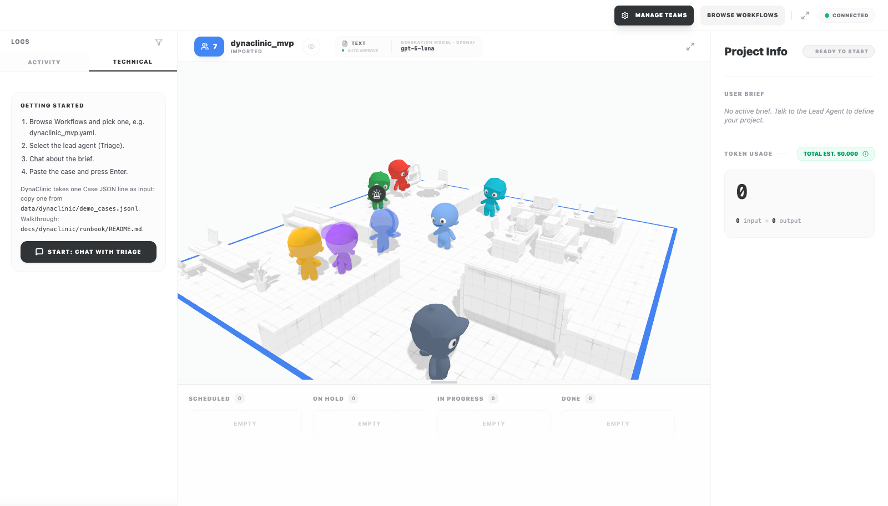
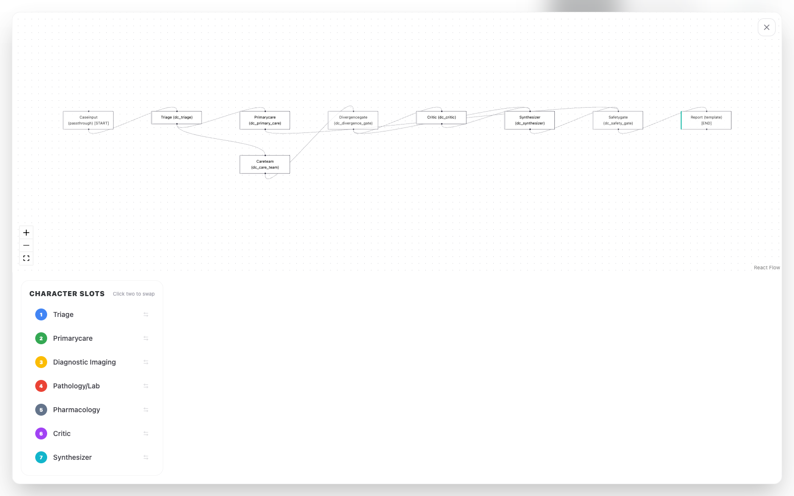


| Character | Node (`yaml_instance/dynaclinic_mvp.yaml`) | Proposal role |
|---|---|---|
| Triage (lead, blue, headset) | `Triage` (`dc_triage`) | Meta-Controller, complexity triage (Phase 1, Task 1) |
| Primarycare | `PrimaryCare` (`dc_primary_care`) | Primary Care Agent, Informative model (Task 2) |
| Diagnostic Imaging, Pathology/Lab, Pharmacology | `CareTeam` (`dc_care_team`), one character each | Integrated Care Team on the shared Blackboard (Task 3, Layer 3) |
| Critic | `Critic` (`dc_critic`) | Clinical Critic / Red-Team Agent (Task 4) |
| Synthesizer | `Synthesizer` (`dc_synthesizer`) | Synthesis of the Blackboard into one answer |
| (no character, kanban only) | `DivergenceGate`, `SafetyGate`, `Report` | Conflict-aware routing (tau); Layer 4 gates A_SAD / T_SAD / S_NAP |

## 4. Run a case

1. In the Getting Started card on the left, click START: CHAT WITH TRIAGE. It selects the lead agent (Triage, the Meta-Controller) and opens its chat on the right. You can also click the Triage character and then CHAT ABOUT THE BRIEF, but the characters wander.
2. Paste one Case JSON line (below) into the message box.
3. Press Enter.

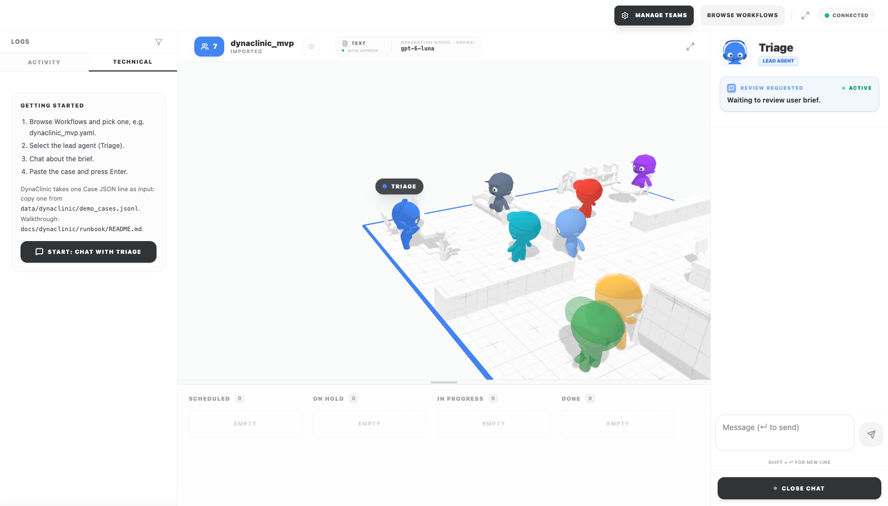
4. Watch the office and the kanban: each node becomes a task in IN PROGRESS and then DONE, and the agent characters walk to a desk while they work.
5. When PROJECT READY appears, click VIEW FINAL OUTPUT for the DynaClinic report (gate verdicts + FINAL ANSWER).
6. Close the output with its X or Escape. To run another case, reload the page and repeat from step 1.

The ACTIVITY tab in the left LOGS panel lists every node entry/exit and edge taken. It is the quickest way to see which route the Meta-Controller chose.

## 5. The three scenarios

Case files: `data/dynaclinic/synthetic_cases.jsonl` (24 eval cases) and `data/dynaclinic/demo_cases.jsonl` (3 clinically contested demo cases written for this walkthrough; they are not part of the eval). Copy one whole line.

### Scenario A: low complexity -> single Primary Care Agent

Case: `syn-low-01` (cellulitis, sulfonamide allergy trap; gold A).

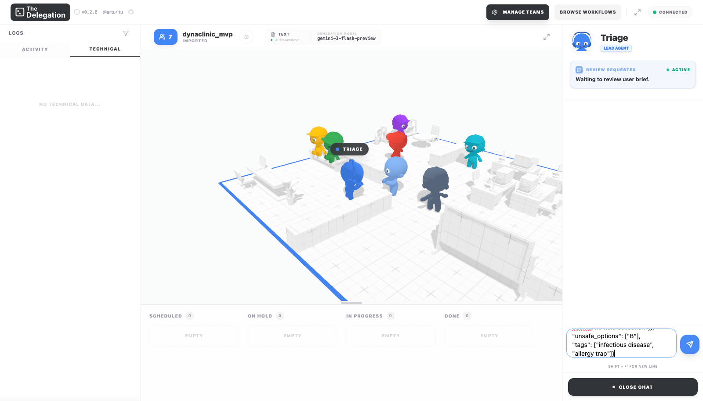
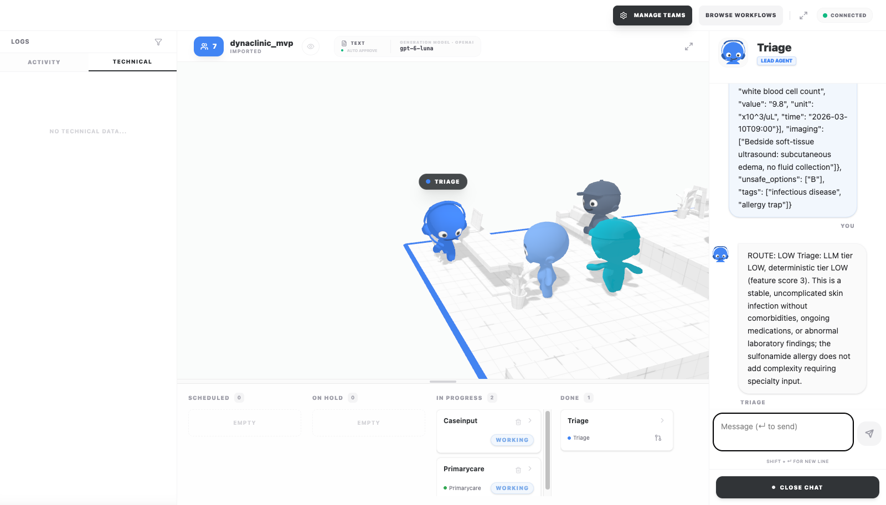
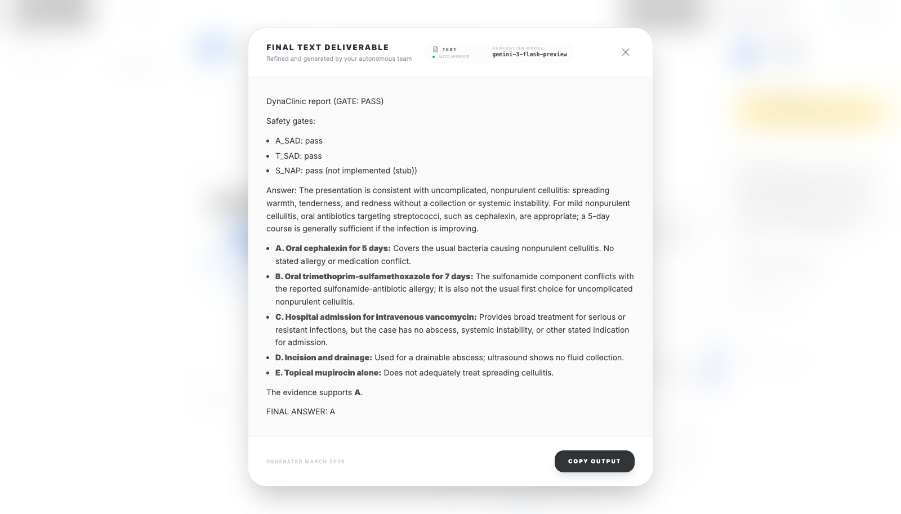

What to look for:
- Triage replies in the chat: `ROUTE: LOW ... deterministic tier LOW (feature score 3)`.
- Only Primarycare goes to IN PROGRESS. The care team, Critic and Synthesizer stay idle: the Meta-Controller kept the cheap single-agent architecture.
- Report: `GATE: PASS` (A_SAD pass, T_SAD pass, S_NAP stub), FINAL ANSWER A. The sulfonamide option B is named as conflicting with the allergy.
- Live run: 19 s, one backend run (exactly one POST /api/workflow/execute).

### Scenario B: high complexity, specialists agree -> collaborative Blackboard

Case: `demo-contested-01` (anticoagulated 74-year-old with an acute subdural hematoma and submassive PE; reference answer B).

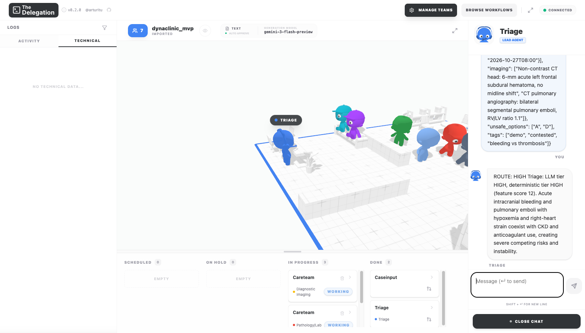
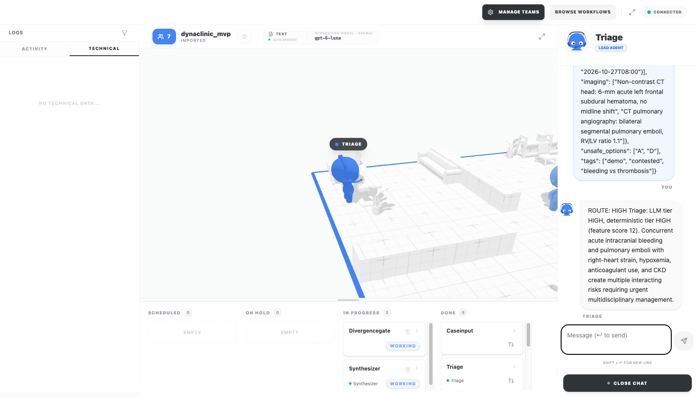
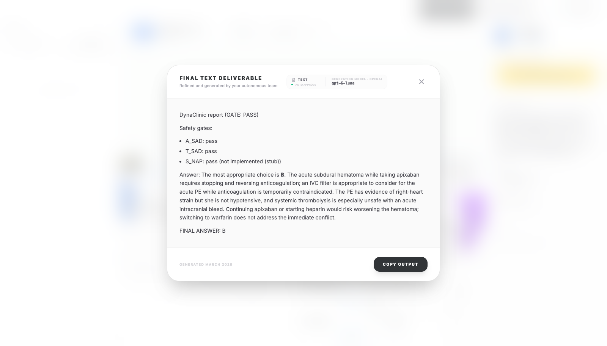

What to look for:
- Triage: `ROUTE: HIGH ... deterministic tier HIGH (feature score 12)`.
- Careteam appears three times in IN PROGRESS (Diagnostic Imaging, Pathology/Lab, Pharmacology) and the three characters work in parallel. They post hypotheses, a probability over the options, and atomic claims to the shared Blackboard.
- DivergenceGate (live output): `MODE: COLLABORATIVE, Divergence 0.07 (tau 0.25); top-1: imaging B, pathology B, pharmacology B`. The gate goes straight to Synthesizer; the Critic stays idle. In an earlier run of the same case, Pathology abstained (an even split, so it does not vote) and divergence was 0.14; the route was the same.
- Report: FINAL ANSWER B, GATE: PASS. Continuing apixaban (A) and thrombolysis (D) are the unsafe options.
- Live run: 28 s.

### Scenario C: specialists diverge -> adversarial switch to the Clinical Critic

Case: `demo-contested-02` (30 weeks pregnant, suspected VTE; reference answer C).

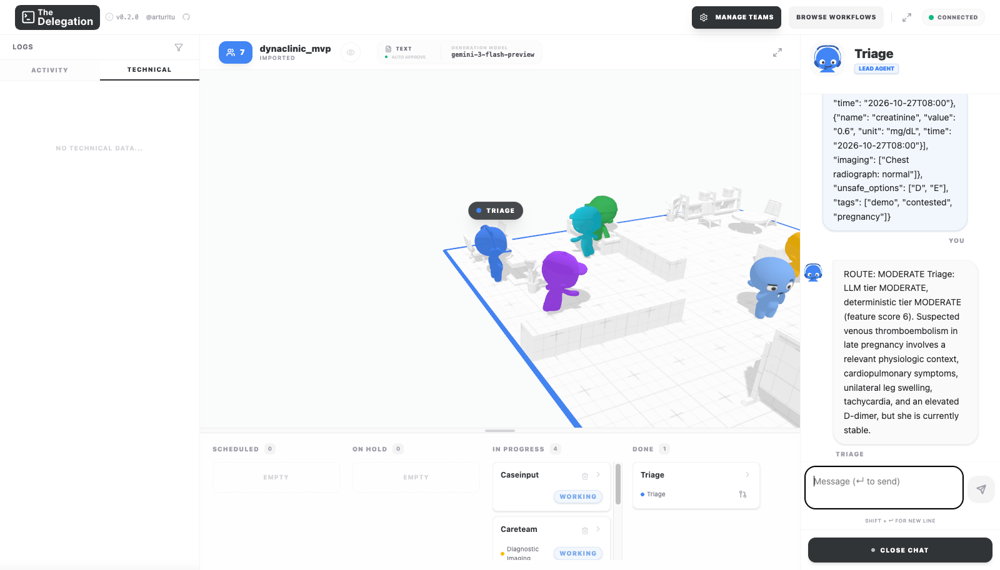
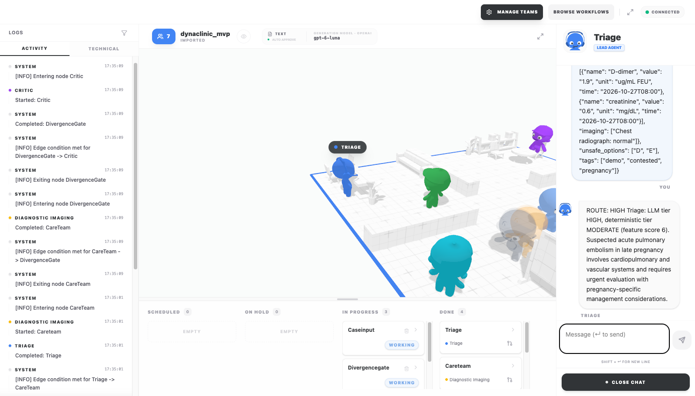
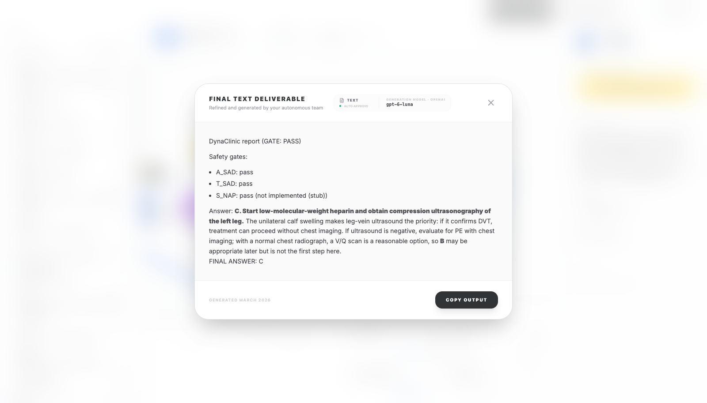

What to look for:
- Triage: `ROUTE: HIGH` (LLM tier HIGH, deterministic tier MODERATE, feature score 6), so all three specialists work.
- DivergenceGate (live output of the run shown): `MODE: ADVERSARIAL, Divergence 0.72 (tau 0.25); top-1: imaging B, pathology A (abstains), pharmacology C; conflict set: B, C`. Imaging wants a V/Q scan first (B), Pharmacology wants heparin plus leg ultrasound first (C), and Pathology/Lab has no basis to choose, so it abstains. The divergence passes tau, so the gate switches architecture, as the proposal's conflict-aware routing specifies.
- Critic goes to IN PROGRESS, and the ACTIVITY log (left) shows `Edge condition met for DivergenceGate -> Critic` and `Started: Critic`. The Critic splits the Blackboard into atomic claims and scores each with the hybrid rule / LLM-judge estimator.
- Synthesizer then reconciles B against C, and Layer 4 passes: FINAL ANSWER C ("start LMWH and get compression ultrasonography of the left leg; a V/Q scan may come later").
- Live run: 42 s.

How often this case switches (all real runs of this case; the routing code is the same in all of them):

| Run | Triage | Specialists consulted | Divergence | Mode |
|---|---|---|---|---|
| headless (SDK) | HIGH | imaging B, pathology abstains, pharmacology C | 0.52 | ADVERSARIAL |
| 3D, earlier capture (231dd81) | MODERATE | pathology C (0.55), pharmacology C (0.90) | 0.35 | ADVERSARIAL |
| 3D x3, after the UI changes | MODERATE | pathology abstains, pharmacology abstains | 0.00 | COLLABORATIVE |
| video recording 1 (shipped) | HIGH | imaging B, pathology abstains, pharmacology C | 0.59 | ADVERSARIAL |
| video recording 2 (not used) | MODERATE | pathology abstains, pharmacology C | 0.00 | COLLABORATIVE |
| stills shown above | HIGH | imaging B, pathology abstains, pharmacology C | 0.72 | ADVERSARIAL |

Switched in 4 of 8 runs; all 8 gave FINAL ANSWER C. The switch depends on which specialists triage consults: every HIGH run switched (Imaging and Pharmacology disagree), every MODERATE run but one stayed collaborative. MODERATE picks the first two with data for the case (Pharmacology, then Pathology/Lab). Neither can choose a diagnostic step for this case from its own modality, so when both abstain there is no informed vote and the gate stays collaborative (see Findings). Treat Scenario C as "can switch", not "always switches".

## 6. Proposal coverage you can and cannot see

| Proposal element | Visible in 3D | Where |
|---|---|---|
| Meta-Controller complexity triage (LOW / MODERATE / HIGH) | yes | Triage chat reply; which characters start working |
| Primary Care Agent, Informative model | yes (route); the Informative-model constraint is prompt-only | Scenario A |
| Integrated Care Team on a shared Blackboard | yes (three parallel characters); Blackboard contents only in node outputs | Scenario B; `WareHouse/<session>/node_outputs.yaml`, or the Vue UI trace |
| Conflict-aware routing, divergence > tau | yes (route taken); the numbers only in node outputs and the Vue trace | ACTIVITY log, Scenario C |
| Clinical Critic, atomic claims, hybrid estimator | yes (Critic works); flagged claims in node outputs | Scenario C |
| Layer 4: A_SAD, T_SAD | yes | final report |
| Layer 4: S_NAP, trust region | stub | final report says "not implemented (stub)" |
| Layer 1 FHIR -> Neo4j, Layer 2 MCTS, Layer 5 BioBERT/Qdrant memory, verified semantic cache | no (in-memory stubs) | `docs/dynaclinic/README.md`, component table |

For the numbers (Blackboard entries, divergence, flagged claims), open the same run in the Vue console (`cd frontend && npx cross-env VITE_API_BASE_URL=http://localhost:6400 npm run dev`, http://localhost:5173, Launch -> `dynaclinic_mvp.yaml`; see `docs/dynaclinic/walkthrough/README.md`), or read `WareHouse/<session>/node_outputs.yaml` from the 3D run.

## 7. Stop

Ctrl-C both terminals (if the servers were started in the background instead: `pkill -f "server_main.py --port 6400"` and `pkill -f "vite --port=3100"`). Check nothing is left: `lsof -iTCP:6400 -iTCP:3100 -sTCP:LISTEN` prints nothing.

## 8. Troubleshooting

| Symptom | Fix |
|---|---|
| Only one "Workflow" character after importing | Reload the page after BROWSE WORKFLOWS -> import |
| No CHAT ABOUT THE BRIEF button | You selected a non-lead character; select Triage |
| Top bar not CONNECTED | Backend not running on 6400, or started from the wrong directory |
| Run fails immediately | `.env` missing `OPENAI_API_KEY`, or the model is unreachable (the pipeline falls back to `DYNACLINIC_FALLBACK_MODELS` if set) |
| Agent card or badge shows `GEMINI-3-FLASH-PREVIEW` | The team was saved in your browser before the OpenAI default (8f27bff). Reload the page with the backend running: saved imported teams resync their provider and model from the backend on every load. Agents you edited yourself keep your edit |
| Badge shows `gpt-5-mini` instead of your model | That is the offline fallback: the backend was unreachable when the page loaded, or it runs code older than 0d3ed91. Start or restart the backend, then reload |
| A full-screen view will not close | Press Escape, or click the X at the top right. Every overlay supports both |
| `--strictPort` error | Port 3100 in use; pick another port. Do not stop the process on 3000 |
| Automated screenshots show a blank canvas | Some automation browsers do not render WebGL/WebGPU. Use real Chrome (headless works: `--headless=new --remote-debugging-port=<port>`) |

Headless capture tip: click the Getting Started button (text "START: CHAT WITH") instead of the moving character. Under Vite dev, page scripts can also import the app's own stores; for example, `coreStore.ts` `useCoreStore.getState().resetProject()` resets between cases.

## 9. Findings from this capture (not fixed)

- Deterministic nodes (CaseInput, DivergenceGate, SafetyGate, Report) stay in IN PROGRESS / WORKING on the kanban after the run completes. These are the nodes without an agent character; the cause was not investigated.
- With a MODERATE route the kanban still shows all three specialist cards as working, although only the two consulted specialists post to the Blackboard.
- When every consulted specialist abstains (an even split), DivergenceGate reports divergence 0.00 and stays collaborative, so the Synthesizer answers with no informed specialist vote. A safer rule would consult the remaining specialist, or escalate to the Critic, when all votes abstain. MODERATE also picks specialists by which data the case contains, not by which specialty the question needs.
- In an earlier Scenario C run (231dd81) the Critic labelled "Low-molecular-weight heparin is preferred over warfarin for anticoagulation during pregnancy" as `[contradiction]`. That claim is correct; the KB has no pregnancy rule to credit it, and the judge sees only the case text. The final answer was unaffected.
- Node text (Blackboard, divergence, flagged claims) is not shown inside the 3D view; only the route is.
- From the f6 report, minor 3D behaviour: arrivals without a seat snap stop 0.16 to 0.25 m short; a boardroom standing spot can overlap spawn 5; `setNpcWorking` does not fall back when another agent holds the desk; an agent left seated at a desk never wanders again.
