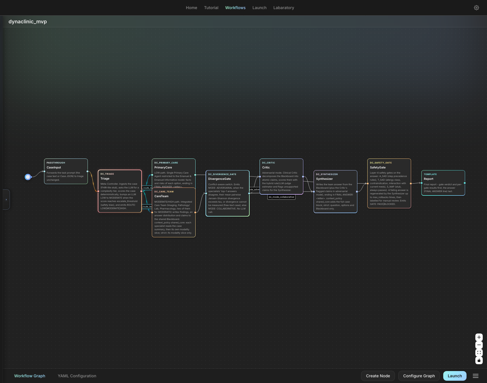
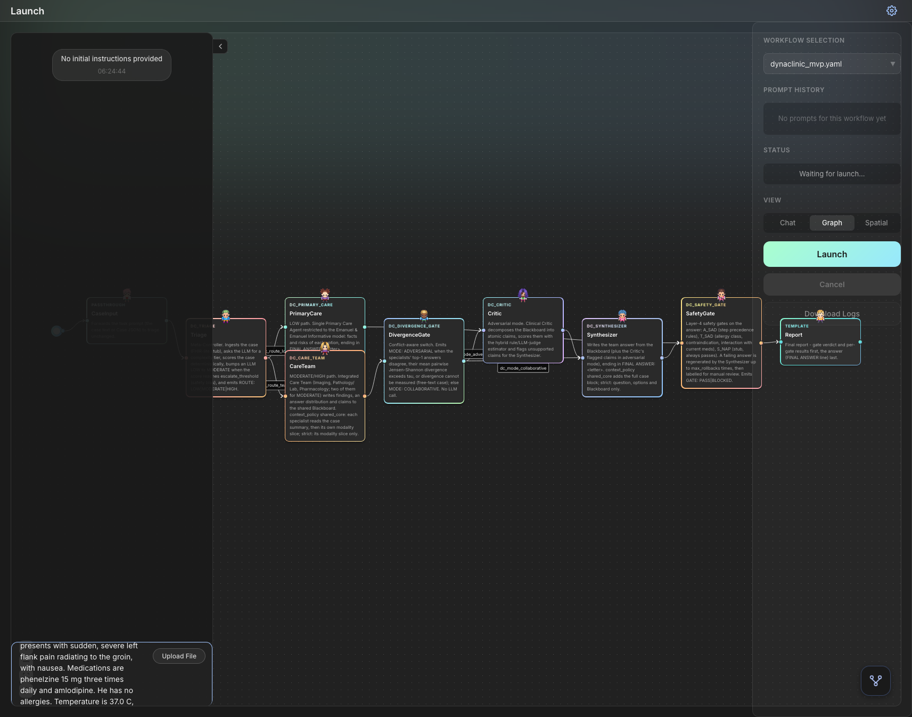
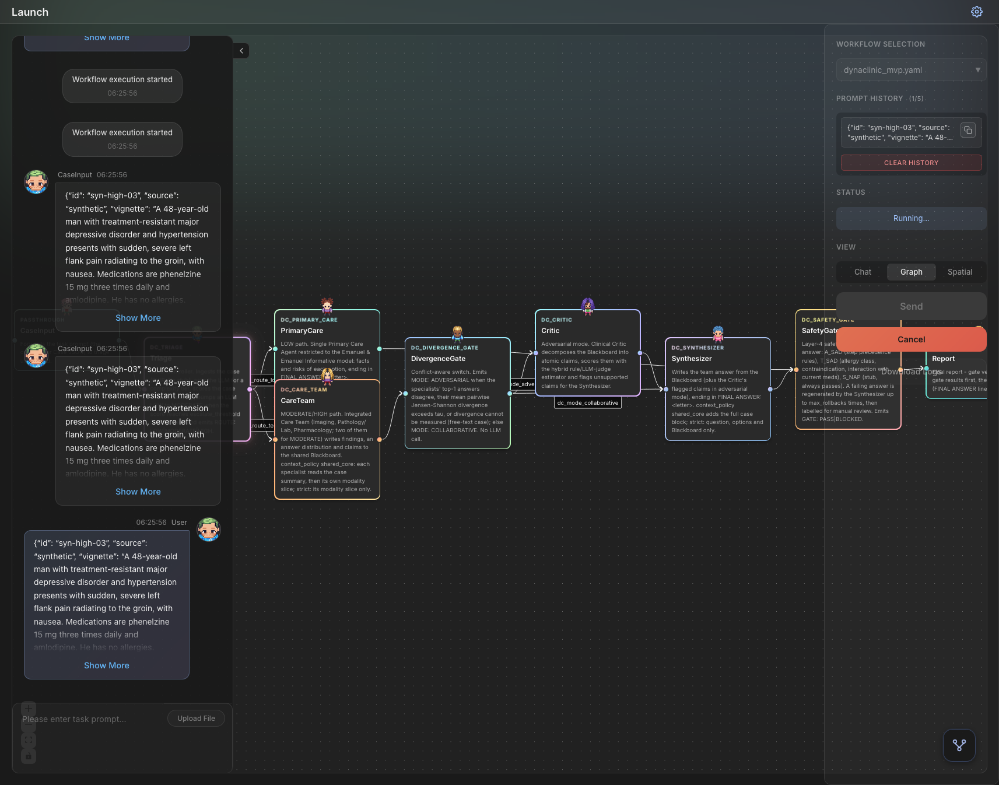
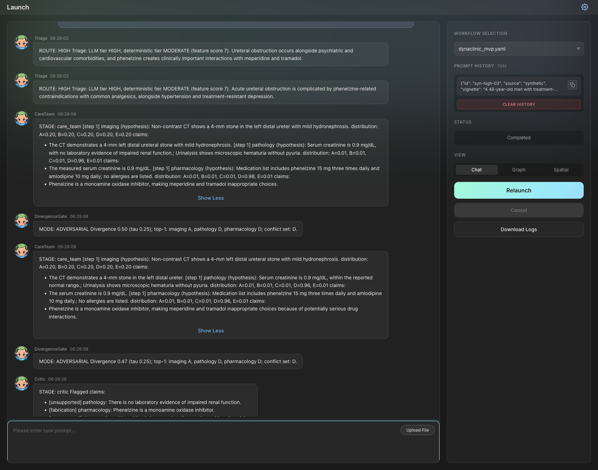
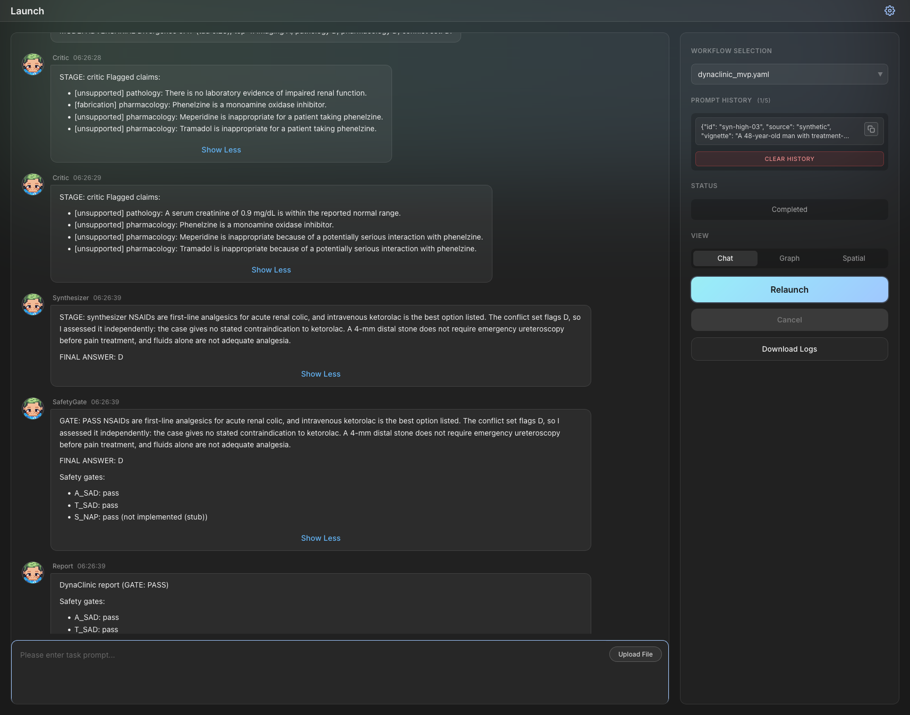
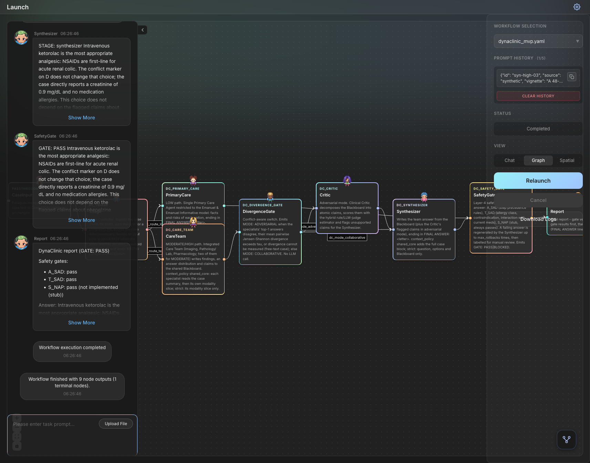

# DynaClinic live walkthrough (DevAll UI)

Captured 2026-10-27 against local servers: backend `server_main.py --port 6400`, frontend Vite on `http://localhost:5173`, model gpt-6-luna, workflow `yaml_instance/dynaclinic_mvp.yaml`, case `syn-high-03` (Case JSON pasted as the task prompt).

Case: 48-year-old on phenelzine (MAOI) with renal colic; question asks for the analgesic. Gold D (IV ketorolac). Traps: B meperidine and C tramadol, both of which interact dangerously with an MAOI.

## 1. Workflow graph (Workflows page)

CaseInput -> Triage -> [dc_route_low] PrimaryCare | [dc_route_team] CareTeam -> DivergenceGate -> [dc_mode_collaborative] Synthesizer | [dc_mode_adversarial] Critic -> Synthesizer -> SafetyGate -> Report. The auto-layout draws CareTeam slightly over PrimaryCare. The edges are correct; you can check them in the accessibility tree.

## 2. Launch page with the case loaded

## 3. Running

## 4. Trace: triage, care team Blackboard, divergence switch

- Triage: `ROUTE: HIGH`. The LLM tier was HIGH and the deterministic tier MODERATE (feature score 7).
- CareTeam Blackboard entries:
  - Imaging: uniform distribution (0.20 each). The CT doesn't decide which analgesic to give.
  - Pathology: D = 0.96.
  - Pharmacology: D = 0.98. Its claim: "Phenelzine is a monoamine oxidase inhibitor, making meperidine and tramadol inappropriate choices".
- DivergenceGate: `MODE: ADVERSARIAL`. Divergence was 0.50, against tau 0.25. Top-1 answers: imaging A, pathology D, pharmacology D. Conflict set: D.

## 5. Critic -> Synthesizer -> SafetyGate -> Report

The final answer is `FINAL ANSWER: D` (IV ketorolac), and the SafetyGate passed: A_SAD pass, T_SAD pass, S_NAP stub.

## Findings from this capture (not yet fixed)

1. **The switch to adversarial mode was spurious.** Imaging abstained with a uniform distribution, but its tie-broken top-1 counted as "A". That created a top-1 disagreement and raised the divergence to 0.50, although the two informative specialists agreed on D. Uniform or near-uniform distributions should count as abstentions in `divergence.assess` (excluded from the top-1 vote and from the pairwise JS mean).
2. **The Critic flags true pharmacology as unsupported.** For example, "Phenelzine is a monoamine oxidase inhibitor" was labelled `[fabrication]` in one run, and "Meperidine is inappropriate with phenelzine" `[unsupported]`. The judge only checks claims against the case text, and the rule score doesn't credit claims that the KB confirms (here, the meperidine/tramadol-MAOI interaction is in kb.py). KB-confirmed warnings should raise the rule score.
3. **One Launch click ran the workflow twice.** The backend log shows two `POST /api/workflow/execute` requests 12 ms apart for session d36c5201, so every node and every LLM call ran twice. `LaunchView.vue` `launchWorkflow()` has no in-flight guard. This is a pre-existing DevAll frontend issue, not specific to DynaClinic, and it doubles cost.
4. The final answer stayed correct and safe despite 1 and 2. They inflate cost (an unneeded critic round) and add noise to the trace.
