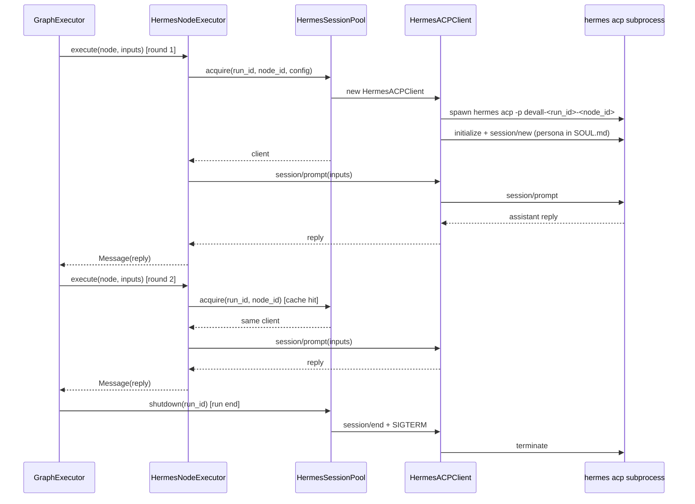
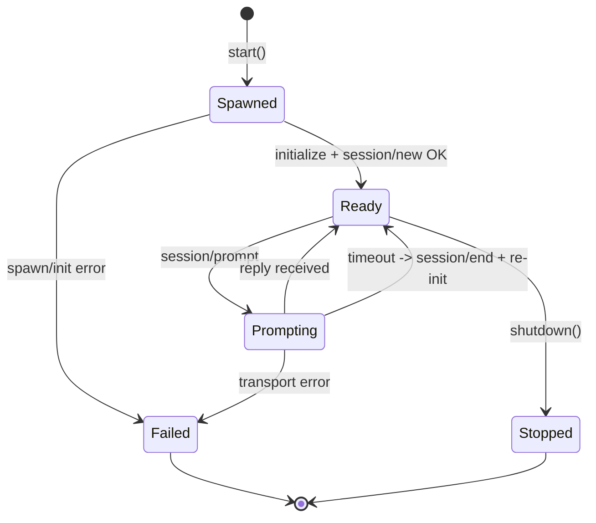

# Hermes Agent Integration — Design

- **Date:** 2026-07-19
- **Status:** Approved (design phase)
- **Topic:** Integrating [NousResearch/hermes-agent](https://github.com/NousResearch/hermes-agent) into DevAll as a first-class node type for scenario simulation

## 1. Problem & Goal

DevAll choreographs multi-agent simulations from YAML workflow graphs: a `GraphExecutor` walks a DAG of typed nodes (`agent`, `literal`, `loop_timer`, `human`, `subgraph`, ...), and edges with conditions/processors carry messages between them. Each `agent` node is currently a stateless OpenAI-API call with a `role` prompt, optional memory, tools, and reflection.

Hermes Agent (Nous Research, MIT, Python) is a single autonomous agent with a self-improving loop: persistent FTS5 memory, auto-created skills, 60+ tools, MCP, cron, subagent spawning, and Honcho dialectic persona modeling. It is built to *run long and self-direct*.

**Goal:** Let a DevAll YAML scenario use hermes-backed role agents that keep a persistent **persona** and **in-run memory** (the doctor remembers earlier rounds within one simulation run), while DevAll retains full control of graph orchestration.

### Non-goals (explicitly out of scope)

- No in-turn autonomy for `hermes` nodes: no tool calls, no subagent spawning, no skill creation inside a node turn.
- No cross-run memory or skill persistence: a `hermes` node's memory dies when the run ends.
- No replacement of DevAll's `agent` node or memory module; `hermes` is an additional, opt-in node type.
- No vendoring or pip-install of hermes from DevAll; hermes is an operator-installed prerequisite.

## 2. Key decisions (from brainstorming)

| Decision | Choice | Rationale |
|---|---|---|
| Control model | DevAll drives the graph; hermes acts per node | Keeps DevAll's deterministic choreography; hermes adds stateful persona/memory inside each node turn |
| Hermes capabilities exposed | In-run persistent memory per role + persona per role | The two capabilities DevAll's static `role` string + per-node memory don't already express well together |
| Capabilities not exposed | In-turn autonomy (tools/subagents/skills), cross-run memory/skills | Narrower integration, lower latency/nondeterminism, cleaner boundary |
| Integration surface | ACP stdio adapter (`hermes acp`) | Stable, documented, process-isolated — same path IDEs use to drive hermes |
| Integration shape | New first-class `hermes` node type via `register_node_type` | Clean black-box boundary; hermes upgrades don't break DevAll; no dependency conflicts |
| Model/provider config | Defer to hermes's own config (`hermes model`) | Hermes has the broader/more flexible provider layer; avoid duplicating it in DevAll YAML |

## 3. Architecture & component boundaries

Four new units, each with one job, registered through DevAll's existing extension points. No changes to `GraphExecutor`, the edge/condition/processor engine, or existing node types.

### 3.1 `entity/configs_hermes.py` — `HermesNodeConfig`
Pure-data dataclass holding the node's declarative config: `persona`, `turn_limit_seconds`, `max_turns`. Validated by the existing schema registry like every other node type. No behavior.

### 3.2 `runtime/node/executor/hermes_executor.py` — `HermesNodeExecutor`
Implements the `NodeExecutor` interface (`runtime/node/executor/base.py`). The only unit that knows hermes exists from DevAll's perspective. On first execution it acquires a live hermes session from the pool; on every execution it sends the merged input text and returns hermes's reply as a DevAll `Message`. Does not know about edges, conditions, or loop gates. Depends on `HermesSessionPool`, `HermesNodeConfig`, and the existing `agent`-node input-merge helper (reused, not copied).

### 3.3 `runtime/node/agent/hermes/acp_client.py` — `HermesACPClient`
Thin JSON-RPC client over stdio for the ACP protocol. Owns one `hermes acp` subprocess lifecycle: `start()`, `session/new`, `session/prompt`, `session/end`, `stop()`. The one file that pins to a hermes/ACP version, so a protocol change is a one-file fix. No dependency on DevAll graph internals — standalone and testable.

### 3.4 `runtime/node/agent/hermes/pool.py` — `HermesSessionPool`
Maps `(run_id, node_id)` to a live `HermesACPClient` so the same role agent survives across loop iterations within one run, and tears all clients down at run end. `shutdown(run_id)` is called from the graph runner's teardown on success, failure, and cancellation.

### 3.5 Supporting units
- `runtime/node/agent/hermes/errors.py` — exception hierarchy (`HermesError` base; `HermesRuntimeError`, `HermesACPProtocolError`, `HermesTimeoutError`).
- `runtime/node/agent/hermes/profile.py` — profile bootstrap: copy a base hermes profile to `devall-<run_id>`, write `SOUL.md` from `persona`, write a minimal `config.yaml` disabling tools/subagents/MCP.

### 3.6 Module map

```mermaid
flowchart LR
  subgraph DevAll["DevAll process"]
    GE["GraphExecutor"] -->|execute node| NE["HermesNodeExecutor"]
    NE -->|get/create session| POOL["HermesSessionPool
    keyed by run_id+node_id"]
    POOL --> CLI["HermesACPClient
    JSON-RPC over stdio"]
    NE --> PROF["profile.py
    build devall-<run_id>-<node_id> profile"]
  end
  CLI -->|stdin/stdout| subgraph HERMES["hermes acp subprocess (one per role)"]
    HA["AIAgent + FTS5 session + SOUL.md persona"]
  end
  HA -->|reply| CLI --> NE -->|Message output| GE
  GE -.->|run teardown| POOL
```

### 3.7 What stays untouched
`GraphExecutor`, edge/condition/processor engine, all existing node types, and DevAll's own memory module. A `hermes` node uses **hermes's** in-run FTS5 session storage, not DevAll's memory module — this avoids double-memory and respects the "in-run, dies at end" decision. Non-role agents (data generators, report aggregators) stay as `agent` nodes; `hermes` is a drop-in replacement for `agent` only where in-run persona/memory continuity matters.

## 4. Data flow & YAML authoring surface

### 4.1 Per-run lifecycle
A workflow run that contains `hermes` nodes constructs one `HermesNodeExecutor` via the existing factory. The executor is lazy — nothing spawns at construction time. On the first execution of a given `hermes` node:
1. `HermesSessionPool.acquire(run_id, node_id, config)` checks its dict.
2. On a miss, `profile.py` builds the `devall-<run_id>-<node_id>` hermes profile (copy base profile, write `SOUL.md` from this node's `persona`, write minimal `config.yaml` disabling tools/subagents/MCP). Each `hermes` node in a run gets its own profile because each role has its own persona.
3. A `HermesACPClient` is constructed, `client.start()` spawns `hermes acp -p devall-<run_id>-<node_id>` as a subprocess, performs the ACP `initialize` handshake, and calls `session/new`.
4. The client is cached at `(run_id, node_id)`.

Subsequent executions of the same node within the same run reuse the cached client — that is how a role agent remembers earlier rounds.

### 4.2 Per-turn flow
For each graph edge delivering a message to a `hermes` node:
1. `HermesNodeExecutor.execute(node, inputs)` flattens `inputs` (list of `Message`) into text using the same merge logic the existing `agent` node uses (reused, not copied).
2. Sends one `session/prompt` JSON-RPC request with that text. Hermes runs its internal conversation loop (no tools/subagents — disabled by the profile's `config.yaml`) and returns one assistant reply.
3. The executor wraps the reply as a DevAll `Message(role=assistant, content=reply)` and returns it. The GraphExecutor then applies outgoing edge `processor`, conditions, and routing exactly as for any other node.

### 4.3 Teardown
When the GraphExecutor finishes a run (success, failure, or cancellation), it calls `pool.shutdown(run_id)`: each live client sends `session/end`, then SIGTERM, 5s grace, SIGKILL. In parallel across all live clients. Every `devall-<run_id>-<node_id>` profile directory for that run is deleted. In-run FTS5 memory is discarded with the profiles.



### 4.4 YAML authoring surface

A new `hermes` node type alongside `agent`, `literal`, etc. Minimal config with sensible defaults:

```yaml
- id: DoctorAgent
  type: hermes
  config:
    persona: |
      You are Dr. Sarah Chen, an ER attending physician in a busy urban
      hospital. You speak precisely, ask clarifying questions before
      acting, and stay calm under pressure. First-person, in character.
    turn_limit_seconds: 30     # per-message hard timeout, default 60
    max_turns: 1               # hermes reply rounds per execute(), default 1
  description: Simulates the attending physician
  context_window: 0
  log_output: true
```

- **`persona`** (required, non-empty string): written to the hermes profile's `SOUL.md` at run start. Defines the role agent's voice across the whole run.
- **`turn_limit_seconds`** (optional, default 60, positive integer): hard per-`session/prompt` timeout.
- **`max_turns`** (optional, default 1, positive integer): hermes reply rounds per `execute()`.

Everything else (edges, conditions, processors, loops, loop gates) is authored exactly as with `agent` nodes.

### 4.5 Deliberate omissions from `HermesNodeConfig`
No `tools`, `subagents`, `thinking`, `memories`, `retry`, `model`, or `provider` fields. Tools/subagents/thinking/memories are hermes-side concerns we chose not to expose (no in-turn autonomy). Model/provider are deferred to hermes's own config (`hermes model`). If a user wants per-role models, they run separate DevAll runs with different hermes profiles, or (future spec) add per-node profile selection. For now: one profile per run, one model.

## 5. Subprocess lifecycle, profile isolation & ACP client contract

### 5.1 Profile isolation
Each `hermes` node in a run gets its own hermes profile via `-p devall-<run_id>-<node_id>`, so concurrent DevAll runs and distinct roles within one run don't collide on hermes's FTS5/session state, SOUL.md, or config. `profile.py` copies a **base profile** the operator designated (default: hermes's default profile) into `~/.hermes/profiles/devall-<run_id>-<node_id>/`, writes this node's `persona` into `<profile>/SOUL.md`, and writes a minimal `<profile>/config.yaml` that enables only the base conversation loop (no toolsets, no MCP, no delegate). At run end all `devall-<run_id>-<node_id>` profile directories for that run are deleted along with their subprocesses. This guarantees the "in-run, dies at end" memory semantics and per-role persona isolation.

### 5.2 ACP client contract
`HermesACPClient` owns one subprocess and speaks ACP JSON-RPC over stdio. Pinned surface (the only methods we call):

| Method | When | Purpose |
|---|---|---|
| `initialize` | right after spawn | handshake, negotiate protocol version |
| `session/new` | once per role, at `acquire()` | open the conversation hermes keeps across turns |
| `session/prompt` | every `execute()` | send merged input text, await one assistant reply |
| `session/end` | at `shutdown()` | close the session cleanly |
| process SIGTERM → SIGKILL after 5s grace | at run end | terminate the subprocess |

Everything else in ACP (tool approval callbacks, slash commands, streaming events) is ignored. Hermes is configured with no tools, so it won't emit tool-approval requests. Any unexpected notification is a logged warning, not an error.

### 5.3 Subprocess lifecycle states



### 5.4 Concurrency
One subprocess per role, held for the run. A graph with N `hermes` nodes runs N concurrent `hermes acp` subprocesses. DevAll's GraphExecutor already serializes per-node execution by walking the DAG, so only the currently executing node's client is mid-`session/prompt` at any instant — no concurrent prompts on one client. Per-node client ownership guarantees no shared-client contention even if a future DevAll feature parallelizes node execution within a run.

### 5.5 Resource bounds
`turn_limit_seconds` is a hard per-`session/prompt` timeout. On expiry the client cancels the in-flight request, logs it, sends `session/end`, re-opens a fresh session (so the next turn isn't poisoned by a half-reply), and surfaces the timeout as a node error the GraphExecutor can route via DevAll's existing error handling. No unbounded subprocess growth: the pool's `shutdown(run_id)` is registered to run on both success and failure paths of the graph runner.

### 5.6 Host dependency
`hermes` must be installed and on PATH; the client shells out to `hermes acp -p <profile>`. DevAll does not vendor or pip-install hermes — it is an operator prerequisite, checked once at executor construction with a clear error: *"hermes binary not found; set HERMES_BIN or install from https://hermes-agent.nousresearch.com"*. `HERMES_BIN` env var overrides the binary path for non-standard installs.

### 5.7 Protocol version pinning
The exact ACP JSON-RPC message bodies and the protocol version pin are an implementation detail for the ACP client unit and belong in the implementation plan, not this design. The design commits to **pinning a version and isolating it to one file** (`acp_client.py`).

## 6. Error handling & failure semantics

Three failure classes, each routed through DevAll's existing error paths. No new top-level error handling in the graph engine — `hermes` nodes fail the same way `agent` nodes do.

### 6.1 Environment failures
hermes missing, profile creation fails, spawn fails. Raised at executor construction or first `acquire()`. Hard `HermesRuntimeError(RuntimeError)` with an actionable message. The GraphExecutor sees it as a node-execution error; no `retry` field on `hermes` nodes, so by default the run fails fast. Example: `hermes` not on PATH → `HermesRuntimeError("hermes binary not found; set HERMES_BIN or install from https://hermes-agent.nousresearch.com")`.

### 6.2 Transport/protocol failures
ACP handshake fails, `session/prompt` returns malformed JSON, subprocess dies mid-turn. The client transitions to `Failed` and raises `HermesACPProtocolError`. **One internal retry**: kill the dead subprocess, spawn a fresh one, re-open the session **without** persona rewrite (SOUL.md persists in the profile, so persona survives), replay the current turn's prompt. If the retry also fails, surface as a node error. The session's in-run FTS5 memory is lost on respawn because hermes's session id changes — this is an acceptable degradation: the role agent forgets pre-crash context for that one role, the run continues, and the failure is logged at WARN with the lost session id. We do not attempt to replay prior turns; in-run memory is best-effort, not transactional.

### 6.3 Turn timeouts
No reply within `turn_limit_seconds`. Per Section 5.5: cancel, end session, re-open fresh session, surface as node error. A timeout is **not** retried with the same prompt — hermes may be stuck in a loop and re-prompting risks the same outcome. The GraphExecutor decides whether to continue (if the YAML routes around node errors) or abort.

### 6.4 Cancellation propagation
When the GraphExecutor cancels a run (user interrupt or upstream failure), `pool.shutdown(run_id)` runs regardless. Shutdown is best-effort: `session/end` → SIGTERM → 5s grace → SIGKILL, per subprocess, in parallel across all live clients. A subprocess that won't die is logged at ERROR and orphaned (we can't block forever); rare and operator-visible.

### 6.5 Config validation failures
Malformed YAML, missing/empty `persona`, non-integer `turn_limit_seconds`, negative `max_turns`, unknown extra fields. Caught at config validation time by the existing schema registry — `HermesNodeConfig` validation raises `DesignError` (DevAll's existing workflow-config error) before any subprocess spawns. These surface through `check.check` exactly like a malformed `agent` node would.

### 6.6 Exception hierarchy
`runtime/node/agent/hermes/errors.py`:
- `HermesError(RuntimeError)` — base
  - `HermesRuntimeError` — environment/spawn/profile
  - `HermesACPProtocolError` — transport/JSON-RPC
  - `HermesTimeoutError` — per-turn timeout

Each is caught at the `HermesNodeExecutor` boundary and either re-raised (hard failures) or wrapped into a `Message(role=error)` if DevAll's graph routes on error content — matching how the existing `agent` node surfaces failures. No silent swallowing: every failure path logs at least at INFO with run_id, node_id, session_id, and the failure class.

### 6.7 Non-behaviors (deliberate)
No automatic cross-run retry, no fallback to a plain `agent` node if hermes fails (that would silently change simulation semantics), no circuit breaker across runs. Each run is independent; hermes availability is the operator's concern.

## 7. Testing strategy

Test boundaries mirror the unit boundaries. Each unit is tested in isolation; one integration test proves they compose. **Unit tests run without hermes installed.**

### 7.1 `HermesACPClient` — fake subprocess
A `FakeACPProcess` (Python thread or asyncio subprocess echoing valid ACP JSON-RPC responses) replaces `hermes acp`. Tests cover the state machine in Section 5.3:
- happy path: `start → initialize → session/new → session/prompt → reply → shutdown`
- spawn failure (binary missing → `HermesRuntimeError`)
- malformed JSON-RPC reply → `HermesACPProtocolError`, internal retry succeeds
- subprocess dies mid-`session/prompt` → `HermesACPProtocolError`, retry with fresh subprocess
- `turn_limit_seconds` expiry → `HermesTimeoutError`, session re-opened, client back to `Ready`
- `shutdown()` with a stuck subprocess → SIGTERM → SIGKILL path, no hang
- concurrent `session/prompt` on one client is rejected (guards the one-in-flight-prompt invariant)

These tests pin the ACP protocol surface we depend on, so a hermes protocol change shows up as a unit-test failure in one file.

### 7.2 `HermesSessionPool` — pure state, no subprocess
Inject a fake client factory. Tests:
- `acquire(run_id, node_id, config)` caches by `(run_id, node_id)` — same instance across calls within a run
- different `(run_id, node_id)` gets different instances
- `shutdown(run_id)` calls `client.shutdown()` on every live client for that run, in parallel
- `shutdown` is idempotent and safe on a run with no live clients
- a failed `acquire` (client raises during `start`) does not poison the cache — next `acquire` retries

### 7.3 `HermesNodeExecutor` — adapter behavior, fake pool + fake client
Tests:
- first `execute()` triggers `acquire`; subsequent `execute()` reuses (lazy acquisition)
- input `Message` list flattened to text the same way the existing `agent` node does it (reuse its merge logic; test the shared helper)
- `session/prompt` receives the merged text; the returned assistant reply is wrapped as a DevAll `Message(role=assistant, content=reply)`
- client raising `HermesACPProtocolError` → executor re-raises (or wraps as error `Message`, matching existing `agent` node policy — pin one behavior in the test)
- `context_window: 0` and `log_output: true` honored the same way as `agent` nodes

### 7.4 `HermesNodeConfig` validation — schema registry
Tests that the schema registry accepts valid configs and rejects: missing `persona`, empty `persona`, non-integer `turn_limit_seconds`, negative `max_turns`, unknown extra fields (strict). These run through `check.check` so `uv run python -m check.check --path <yaml>` catches malformed `hermes` nodes at validation time, same as every other node type.

### 7.5 Integration test — real-ish end-to-end, hermes optional
Guarded by `@pytest.mark.hermes` and skipped if `HERMES_BIN` is unset or `hermes` isn't on PATH (so CI without hermes stays green). Runs a 3-node graph: `literal → hermes (persona="You are a cheerful counter") → literal`, loops twice, asserts (a) the role agent's second-turn reply references content from the first turn (proves in-run memory works), and (b) the subprocess is gone after the run ends (proves teardown). Lives in `tests/integration/test_hermes_node.py`.

### 7.6 Non-tested (matches deliberate omissions)
No tests for tool dispatch inside hermes (tools disabled), cross-run memory (profiles not persisted), or in-turn subagent spawning (disabled).

### 7.7 Definition of done
`uv run pytest tests/unit/test_hermes_acp_client.py tests/unit/test_hermes_session_pool.py tests/unit/test_hermes_node_executor.py tests/unit/test_hermes_config.py` all pass without hermes installed; the marked integration test passes when hermes is present; `uv run python -m check.check --path yaml_instance/demo_hermes.yaml` validates a sample workflow.

## 8. File layout (new files only)

```
entity/
  configs_hermes.py                      # HermesNodeConfig dataclass
runtime/node/agent/hermes/
  __init__.py
  acp_client.py                          # HermesACPClient (pinned ACP surface)
  pool.py                                # HermesSessionPool
  profile.py                             # devall-<run_id> profile bootstrap
  errors.py                              # HermesError hierarchy
runtime/node/executor/
  hermes_executor.py                     # HermesNodeExecutor (NodeExecutor impl)
tests/unit/
  test_hermes_acp_client.py
  test_hermes_session_pool.py
  test_hermes_node_executor.py
  test_hermes_config.py
tests/integration/
  test_hermes_node.py                    # @pytest.mark.hermes, skipped without hermes
yaml_instance/
  demo_hermes.yaml                       # sample workflow using a hermes node
```

No existing files are modified for behavior. Registration of the `hermes` node type happens via `register_node_type` from `runtime/node/builtin_nodes.py` (or a new adjacent module imported by the same builtin-loader path) — the exact registration site is an implementation-plan detail.

## 9. Open questions for the implementation plan (not this design)

- Exact ACP JSON-RPC message bodies and protocol version to pin in `acp_client.py`.
- Whether `ExecutionContext` exposes a per-run teardown hook we can attach `pool.shutdown(run_id)` to, or whether a small wrapper around the graph runner is needed.
- Exact registration site for the `hermes` node type (follow the pattern already used by `builtin_nodes.py`).
- Whether the existing `agent` node input-merge helper is already factored out as a reusable function or needs to be extracted first (test in 7.3 depends on this).
